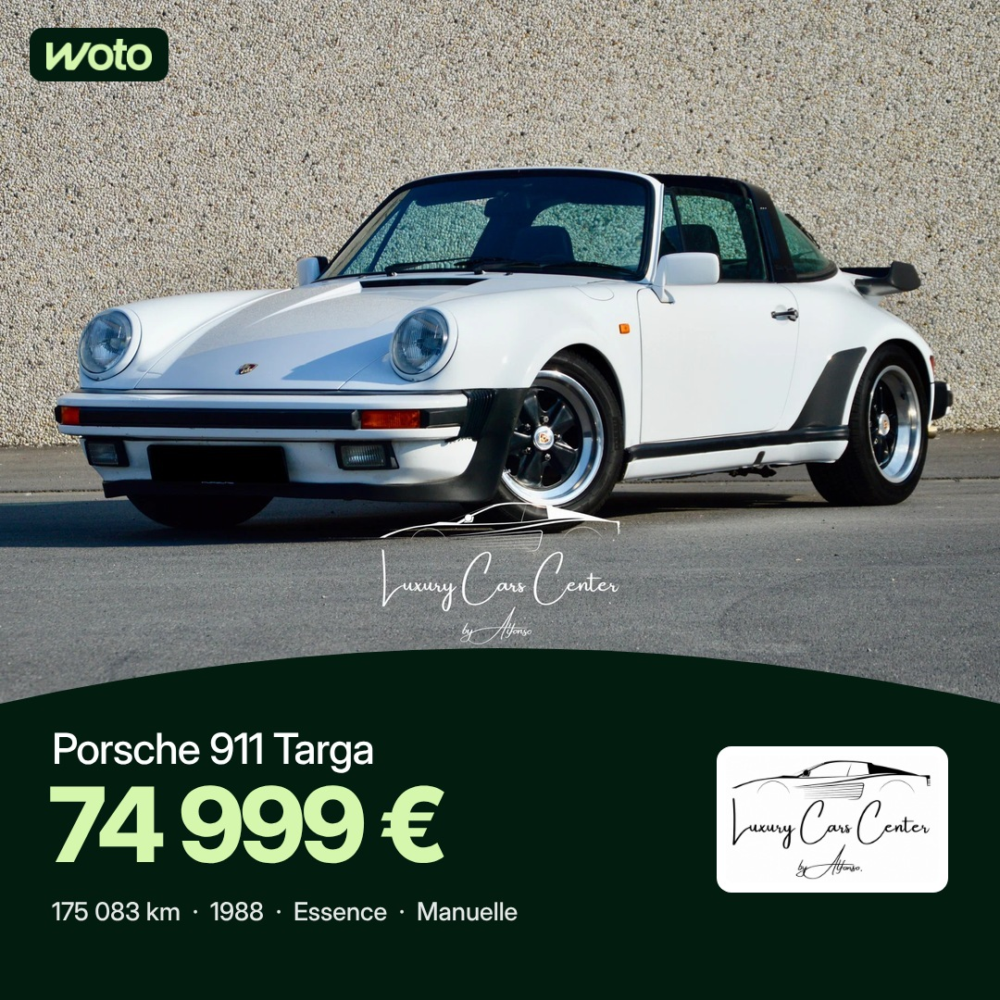

# Projet 2 : publications annonces Woto (fil Facebook et Instagram)

Séparé du projet 1 (stories, voir README.md). Heures de Bruxelles : 7h30 et 17h, programmées 48 h à l'avance. Règles : [RULES-POSTS.md](RULES-POSTS.md).
Facebook 1080 × 1080, Instagram 1080 × 1350. Premier commentaire posté à 7h35 (avec @followers sur Facebook) et 17h05.

## Vendredi 6 novembre (test publié à 14h19)

| Test |
|---|
|  |
| Porsche 911 Targa, Luxury Cars Center By Alfonso |

## Samedi 7 novembre

| 7h30 | 17h |
|---|---|
|  |  |
| Maserati Levante, BCS Franzese | Lancia Ypsilon, Auto Vedette & Fils |

## Dimanche 8 novembre

| 7h30 | 17h |
|---|---|
|  |  |
| Fiat Punto Evo, Wattiez Motors | Dacia Sandero Stepway, Cardoen Mons |
