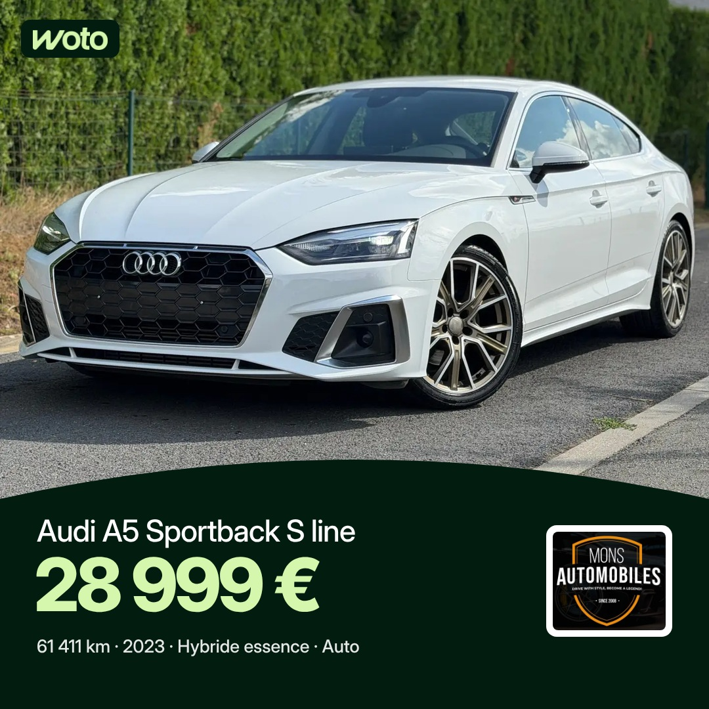

# Projet 2 : publications annonces Woto (fil Facebook et Instagram)

Séparé du projet 1 (stories, voir README.md). Heures de Bruxelles : 7h30 et 17h, programmées 48 h à l'avance. Règles : [RULES-POSTS.md](RULES-POSTS.md).
Facebook 1080 × 1080, Instagram 1080 × 1350. Premier commentaire posté à 7h35 (avec @followers sur Facebook) et 17h05.

## Lundi 23 novembre (7h30 sortie : BMW M4 Competition, BCS Franzese)

| 17h |
|---|
|  |
| Audi A5 Sportback S line, Mons Automobiles (28 999 €) |

## Mardi 24 novembre

| 7h30 | 17h |
|---|---|
|  |  |
| Maserati Levante Modena Ultima, Garage Privé Wavre (74 950 €) | BMW 420i Gran Coupé, DSH Cars (34 990 €) |

## Mercredi 25 novembre

| 7h30 | 17h |
|---|---|
|  |  |
| Renault Espace 1.6 dCi, PP Auto (8 490 €) | Renault Grand Scénic 1.3 TCe Limited, Grs Auto (12 990 €) |
