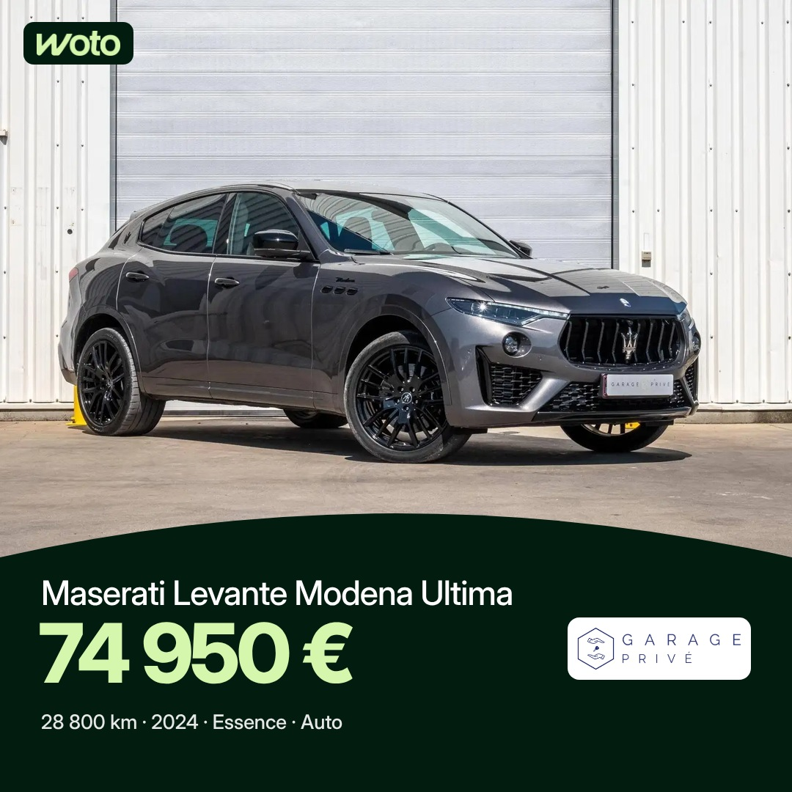
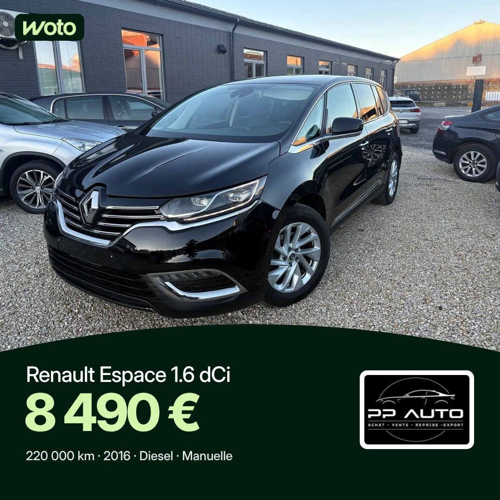
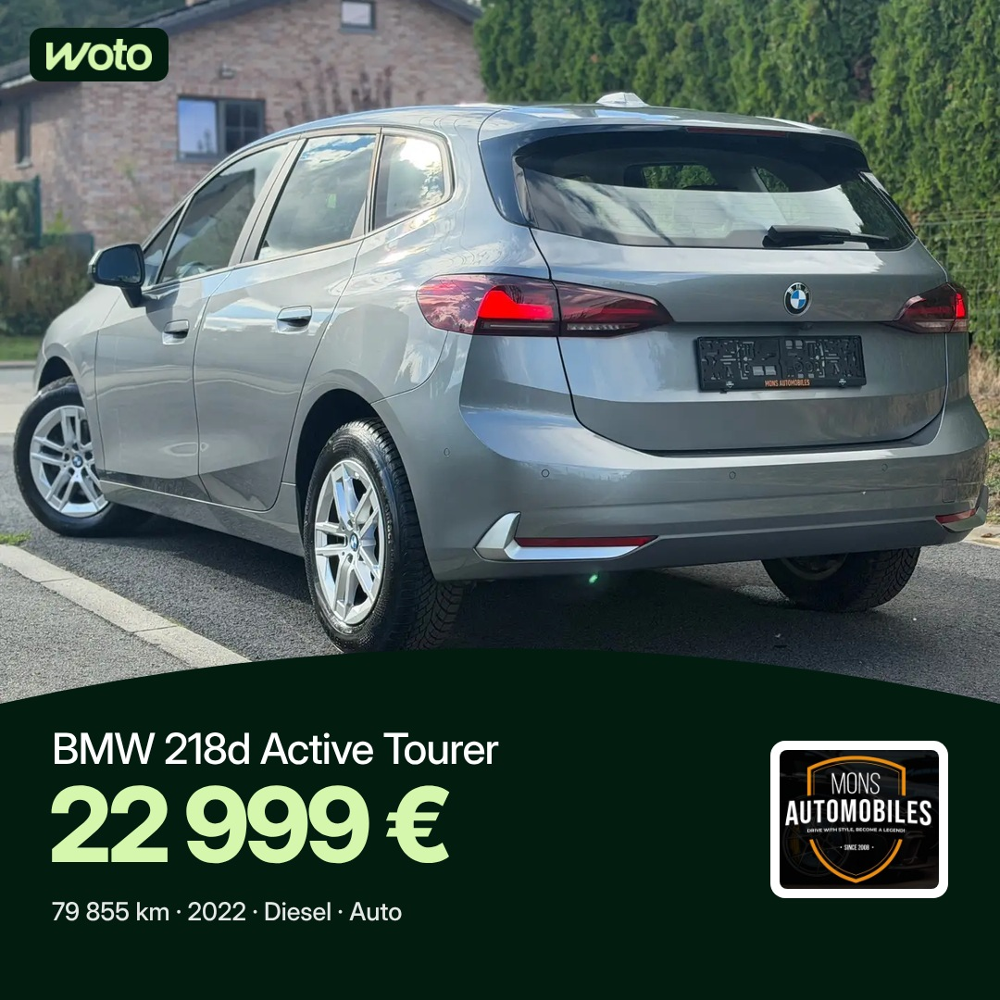

# Projet 2 : publications annonces Woto (fil Facebook et Instagram)

Séparé du projet 1 (stories, voir README.md). Heures de Bruxelles : 7h30, 12h15, 17h00, 19h30 et 21h30, programmées 48 h à l'avance. Règles : [RULES-POSTS.md](RULES-POSTS.md).
Facebook 1080 × 1080, Instagram 1080 × 1350. Premier commentaire posté à 7h35 (avec @followers sur Facebook), 12h35, 17h35, 19h35 et 21h35.

## Lundi 23 novembre

Tous les créneaux du jour sont passés (7h30 BMW M4 Competition, BCS Franzese ; 17h Audi A5 Sportback, Mons Automobiles). 21h30 resté vide : premier passage avec 5 créneaux à 21h52, publication immédiate refusée par l'outil.

## Mardi 24 novembre

| 7h30 | 12h15 | 17h | 19h30 | 21h30 |
|---|---|---|---|---|
|  |  |  |  |  |
| Maserati Levante Modena Ultima, Garage Privé Wavre (74 950 €) | Kia Sportage HEV GT Line, Kia - La Louvière Motors (29 890 €) | BMW 420i Gran Coupé, DSH Cars (34 990 €) | Alfa Romeo Tonale PHEV Speciale, Garage des Chaufours (30 999 €) | Audi TTS Roadster quattro, BCS Franzese (49 990 €) |

## Mercredi 25 novembre

| 7h30 | 12h15 | 17h | 19h30 | 21h30 |
|---|---|---|---|---|
|  |  |  |  |  |
| Renault Espace 1.6 dCi, PP Auto (8 490 €) | Ford Kuga 1.5 EcoBoost, Wattiez Motors (7 899 €) | Renault Grand Scénic 1.3 TCe Limited, Grs Auto (12 990 €) | BMW 418d Gran Coupé, Salaz Motors (14 590 €) | BMW 218d Active Tourer, Mons Automobiles (22 999 €) |
