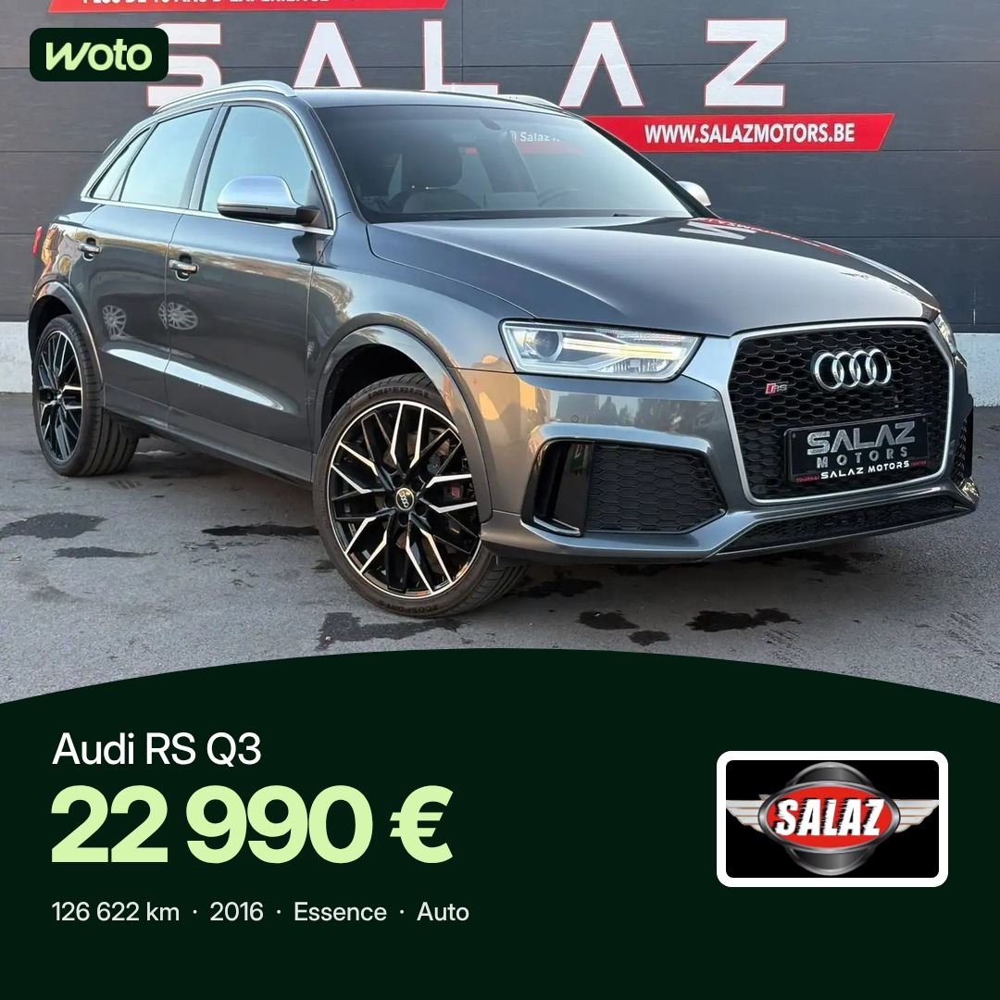

# Projet 2 : publications annonces Woto (fil Facebook et Instagram)

Séparé du projet 1 (stories, voir README.md). Heures de Bruxelles : 7h30 et 17h, programmées 48 h à l'avance. Règles : [RULES-POSTS.md](RULES-POSTS.md).
Facebook 1080 × 1080, Instagram 1080 × 1350. Premier commentaire posté à 7h35 (avec @followers sur Facebook) et 17h05.

## Lundi 9 novembre (7h30 sortie)

| 17h |
|---|
|  |
| Audi RS Q3, Salaz Motors (22 990 €) |

## Mardi 10 novembre

| 7h30 | 17h |
|---|---|
|  |  |
| Kia Sportage, Kia - La Louvière Motors (28 890 €) | Mercedes-Benz GLC 250 d, Mons Automobiles (28 999 €) |

## Mercredi 11 novembre

| 7h30 | 17h |
|---|---|
|  |  |
| Mercedes-AMG A 35, Garage des Chaufours (28 999 €) | Audi RS4 B5 ABT, Luxury Cars Center By Alfonso (34 999 €) |
