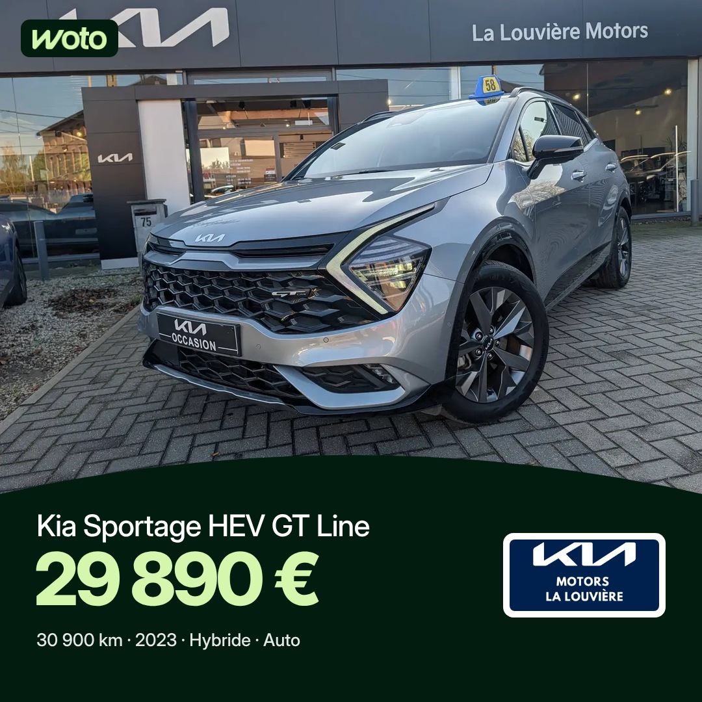
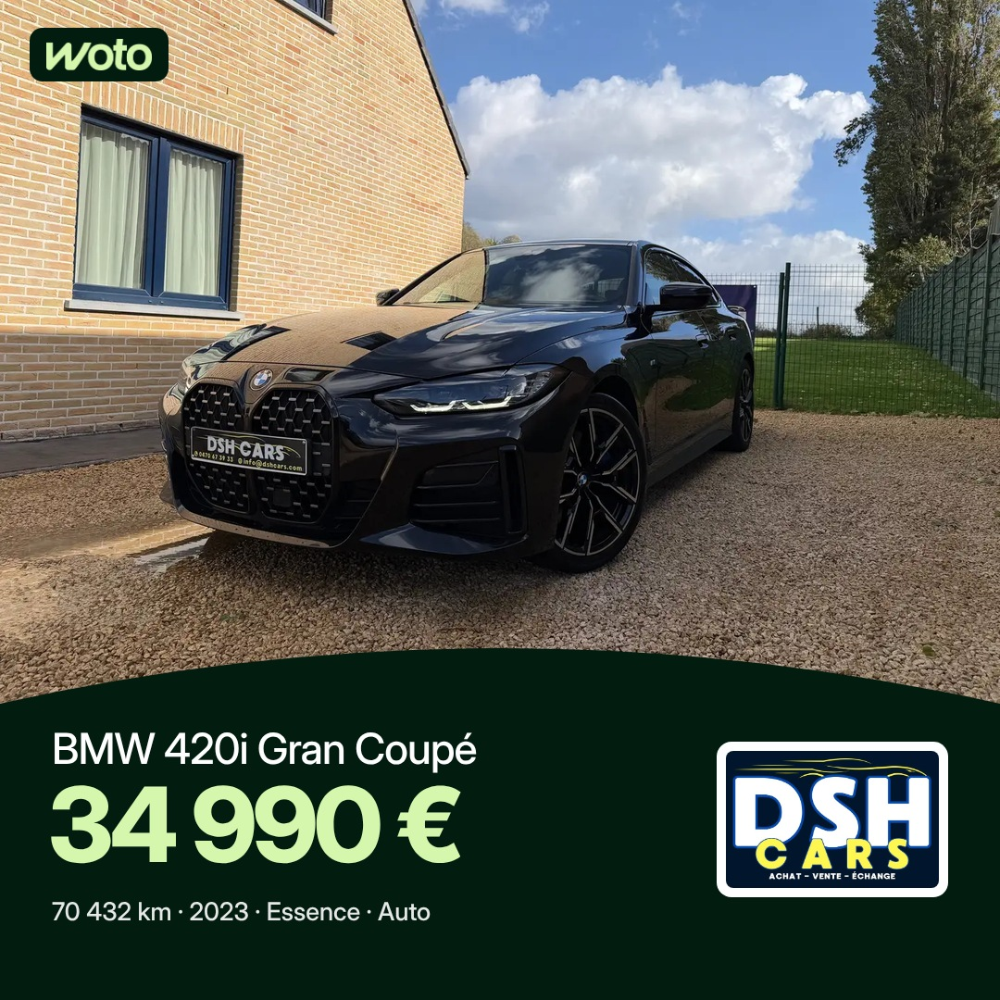
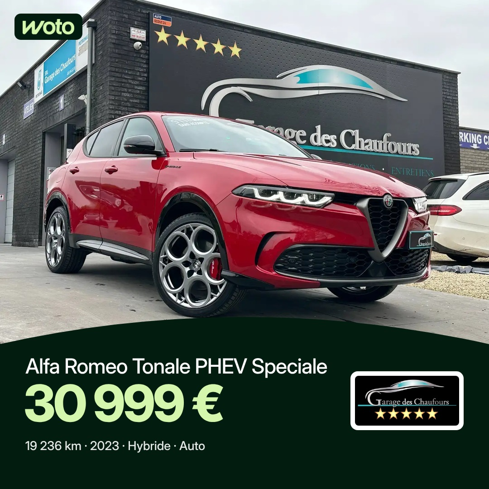
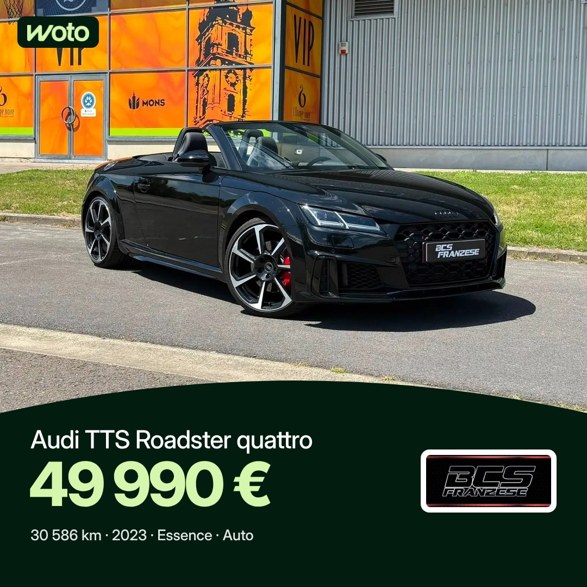
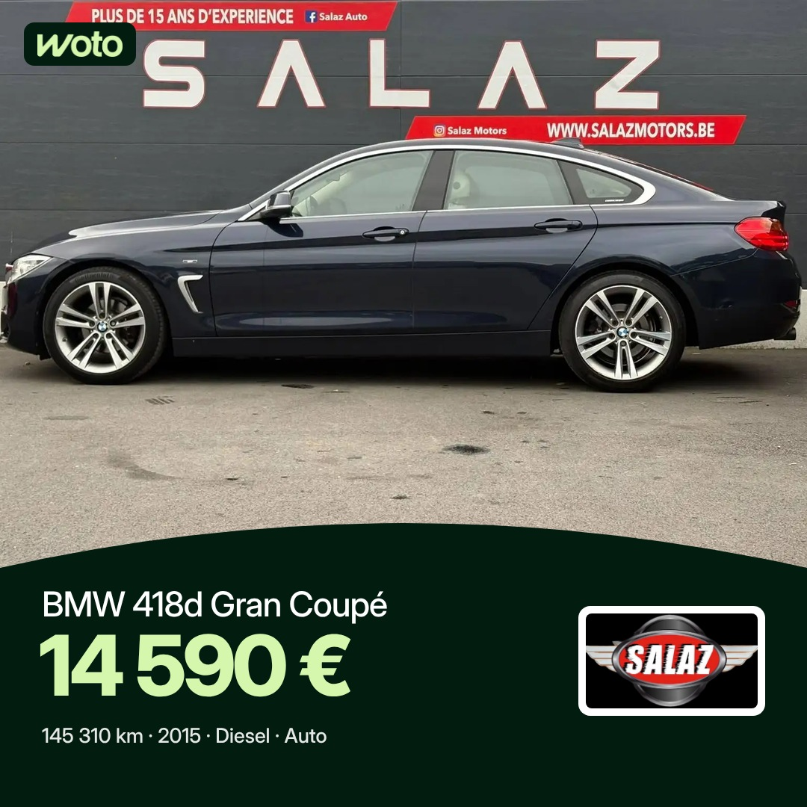

# Projet 2 : publications annonces Woto (fil Facebook et Instagram)

Séparé du projet 1 (stories, voir README.md). Heures de Bruxelles : 7h30, 12h15, 17h00, 19h30 et 21h30, programmées 48 h à l'avance. Règles : [RULES-POSTS.md](RULES-POSTS.md).
Facebook 1080 × 1080, Instagram 1080 × 1350. Premier commentaire posté à 7h35 (avec @followers sur Facebook), 12h35, 17h35, 19h35 et 21h35.

## Mardi 24 novembre

7h30 sortie (Maserati Levante Modena Ultima, Garage Privé Wavre). Créneaux restants :

| 7h30 (sortie) | 12h15 | 17h | 19h30 | 21h30 |
|---|---|---|---|---|
|  |  |  |  |  |
| Maserati Levante Modena Ultima, Garage Privé Wavre (74 950 €) | Kia Sportage HEV GT Line, Kia - La Louvière Motors (29 890 €) | BMW 420i Gran Coupé, DSH Cars (34 990 €) | Alfa Romeo Tonale PHEV Speciale, Garage des Chaufours (30 999 €) | Audi TTS Roadster quattro, BCS Franzese (49 990 €) |

## Mercredi 25 novembre

| 7h30 | 12h15 | 17h | 19h30 | 21h30 |
|---|---|---|---|---|
|  |  |  |  |  |
| Renault Espace 1.6 dCi, PP Auto (8 490 €) | Ford Kuga 1.5 EcoBoost, Wattiez Motors (7 899 € programmé, fiche passée à 7 699 €) | Renault Grand Scénic 1.3 TCe Limited, Grs Auto (12 990 €) | BMW 418d Gran Coupé, Salaz Motors (14 590 €) | BMW 218d Active Tourer, Mons Automobiles (22 999 €) |

## Jeudi 26 novembre

| 7h30 | 12h15 | 17h | 19h30 | 21h30 |
|---|---|---|---|---|
|  |  |  |  |  |
| Mercedes-Benz A 180, SabanAuto Quaregnon (17 990 €) | Renault Trafic VIP 2.0 dCi, Luxury Cars Center By Alfonso (50 000 €, boucle) | Lancia Ypsilon 1.2, Auto Vedette & Fils (4 990 €, boucle) | Citroën Berlingo 1.5 BlueHDi, Cardoen Mons (16 999 €, boucle) | BMW M135i xDrive, Garage Privé Wavre (45 000 €) |
