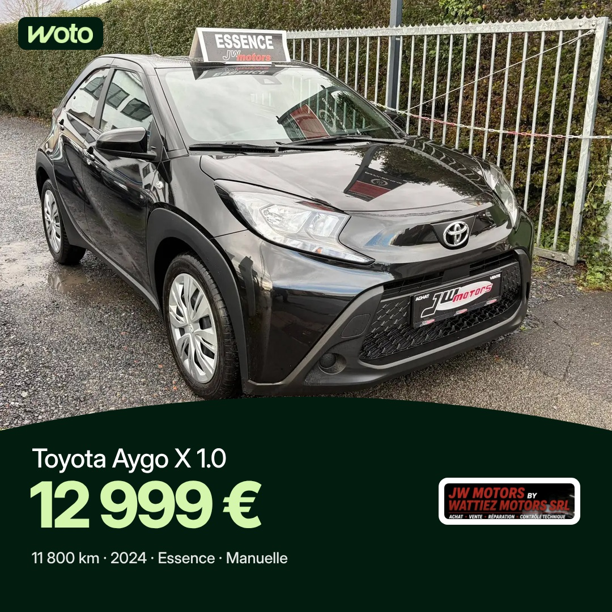
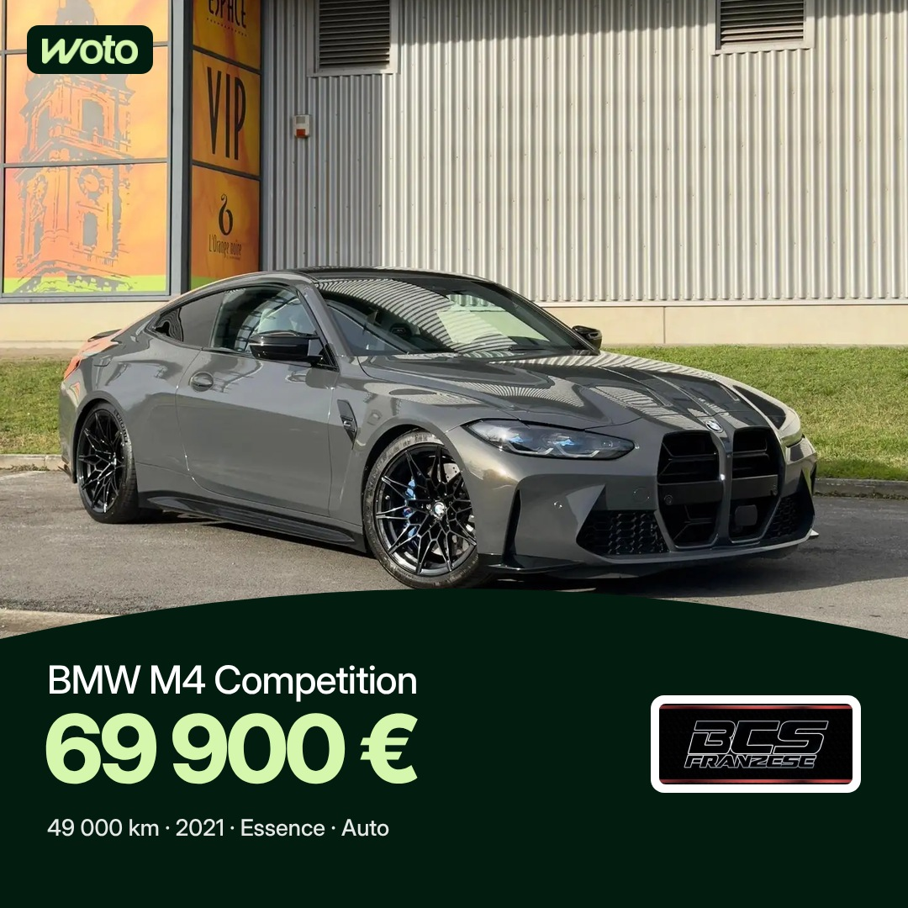

# Projet 2 : publications annonces Woto (fil Facebook et Instagram)

Séparé du projet 1 (stories, voir README.md). Heures de Bruxelles : 7h30 et 17h, programmées 48 h à l'avance. Règles : [RULES-POSTS.md](RULES-POSTS.md).
Facebook 1080 × 1080, Instagram 1080 × 1350. Premier commentaire posté à 7h35 (avec @followers sur Facebook) et 17h05.

## Samedi 21 novembre (7h30 sortie : Peugeot 4008, PP Auto)

| 17h |
|---|
|  |
| BMW 330 Berline, Salaz Motors (30 900 €) |

## Dimanche 22 novembre

| 7h30 | 17h |
|---|---|
|  |  |
| Toyota Aygo X 1.0, Wattiez Motors (12 999 €) ⚠️ plus au stock au scan du 21/11 | Mercedes E 300 Coupé AMG, Garage des Chaufours (34 999 €) |

## Lundi 23 novembre

| 7h30 | 17h |
|---|---|
|  |  |
| BMW M4 Competition, BCS Franzese (69 900 €) | Audi A5 Sportback S line, Mons Automobiles (28 999 €) |
