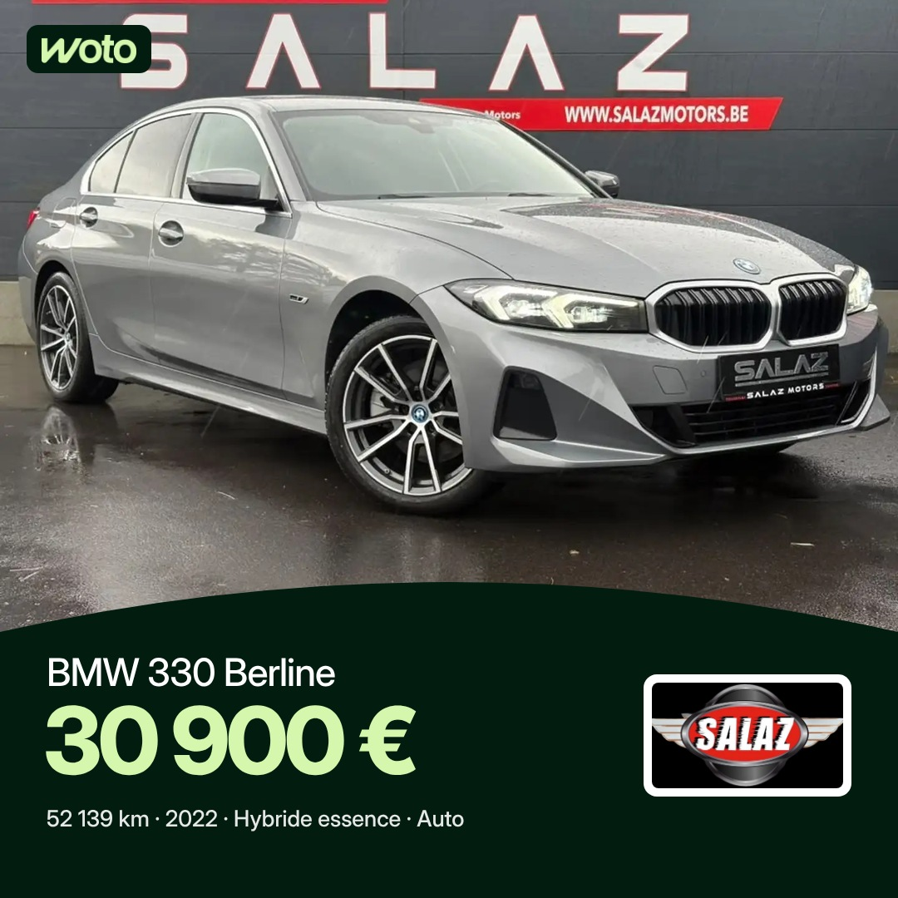

# Projet 2 : publications annonces Woto (fil Facebook et Instagram)

Séparé du projet 1 (stories, voir README.md). Heures de Bruxelles : 7h30 et 17h, programmées 48 h à l'avance. Règles : [RULES-POSTS.md](RULES-POSTS.md).
Facebook 1080 × 1080, Instagram 1080 × 1350. Premier commentaire posté à 7h35 (avec @followers sur Facebook) et 17h05.

## Jeudi 19 novembre (7h30 sortie : BMW X4, DSH Cars)

| 17h |
|---|
|  |
| Porsche Boxster S Black Edition, Garage Privé Wavre (49 500 €) |

## Vendredi 20 novembre

| 7h30 | 17h |
|---|---|
|  |  |
| Ford Puma 1.0 EcoBoost mHEV, Grs Auto (13 990 €) | Audi Q5 Sportback 40 TDI quattro, Kia - La Louvière Motors (39 890 €) |

## Samedi 21 novembre

| 7h30 | 17h |
|---|---|
|  |  |
| Peugeot 4008 1.6 HDi Allure, PP Auto (6 490 €) | BMW 330 Berline, Salaz Motors (30 900 €) |
