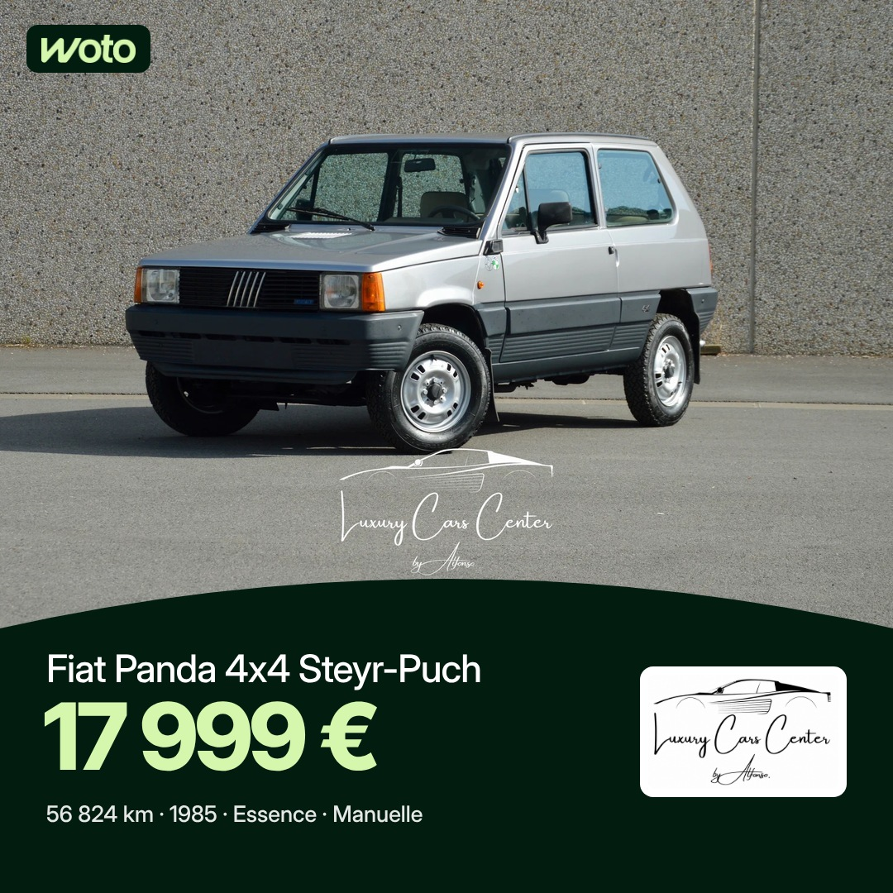
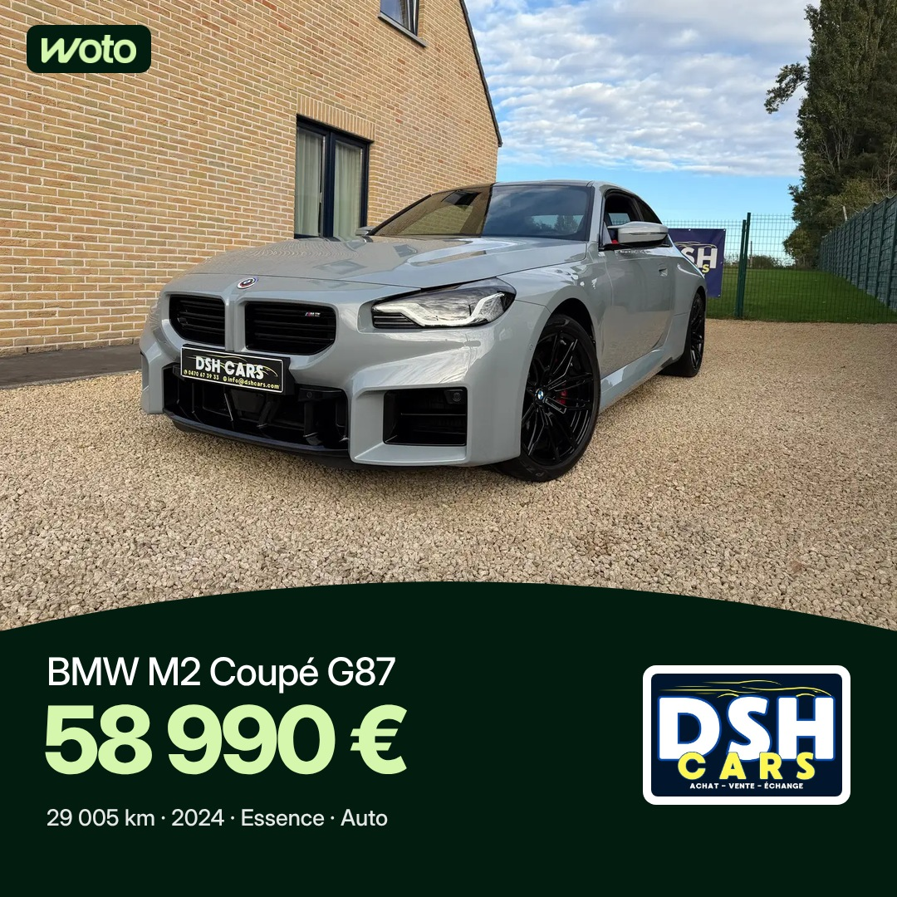
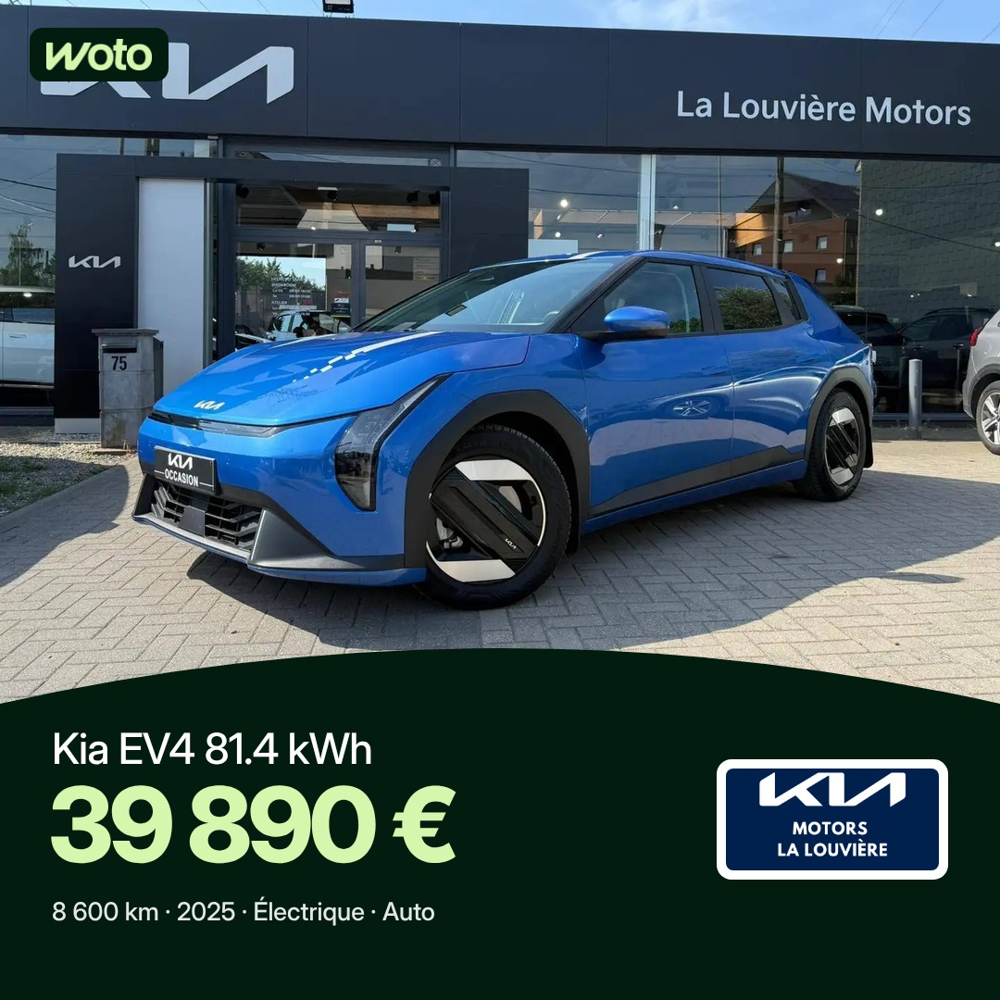

# Projet 2 : publications annonces Woto (fil Facebook et Instagram)

Séparé du projet 1 (stories, voir README.md). Heures de Bruxelles : 7h30 et 17h, programmées 48 h à l'avance. Règles : [RULES-POSTS.md](RULES-POSTS.md).
Facebook 1080 × 1080, Instagram 1080 × 1350. Premier commentaire posté à 7h35 (avec @followers sur Facebook) et 17h05.

## Samedi 14 novembre (7h30 sortie : Audi A4 1.8 TFSI, Wattiez Motors)

| 17h |
|---|
|  |
| Fiat 500L 1.3 Multijet Sport, Auto Vedette & Fils (10 990 €) |

## Dimanche 15 novembre

| 7h30 | 17h |
|---|---|
|  |  |
| Fiat Panda 4x4 Steyr-Puch, Luxury Cars Center By Alfonso (17 999 €) | Range Rover Evoque 2.0 TD4 4WD, Grs Auto (11 990 €) |

## Lundi 16 novembre

| 7h30 | 17h |
|---|---|
|  |  |
| BMW M2 Coupé G87, DSH Cars (58 990 €) | Kia EV4 81.4 kWh, Kia - La Louvière Motors (39 890 €) |
