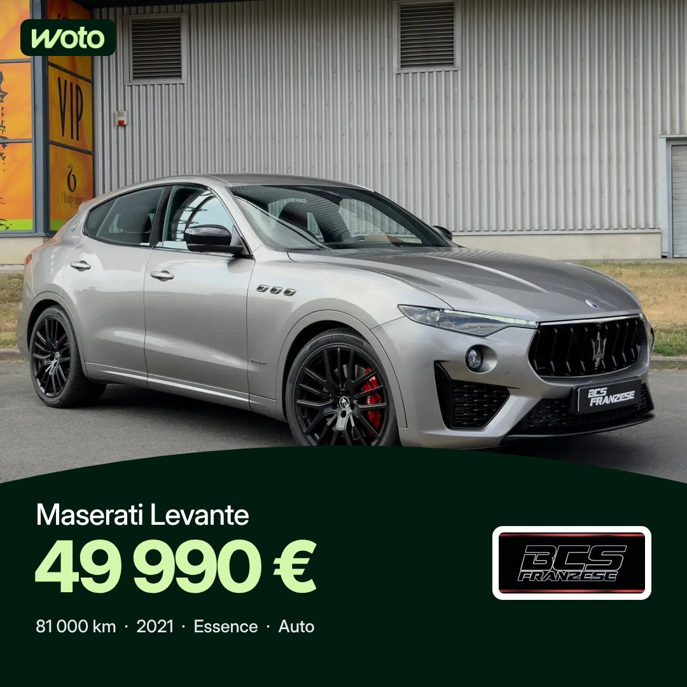
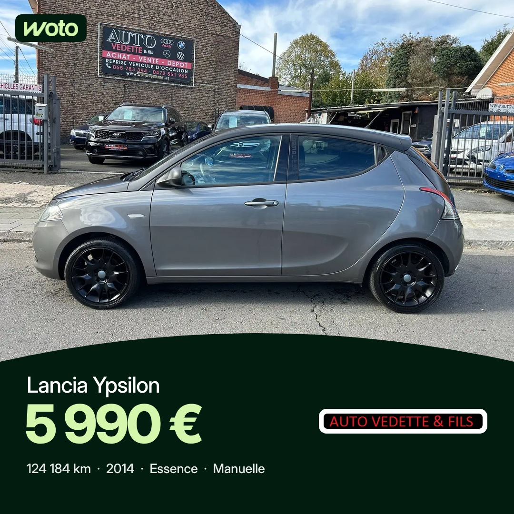
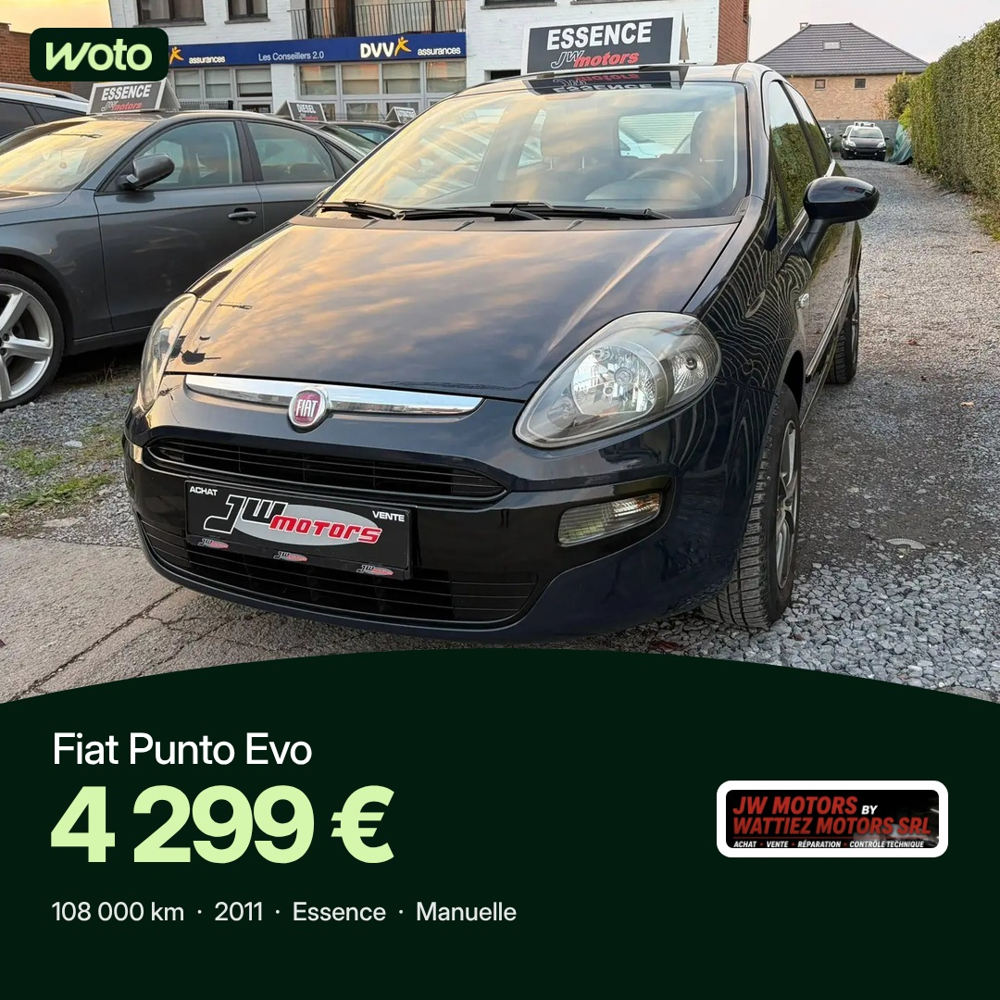
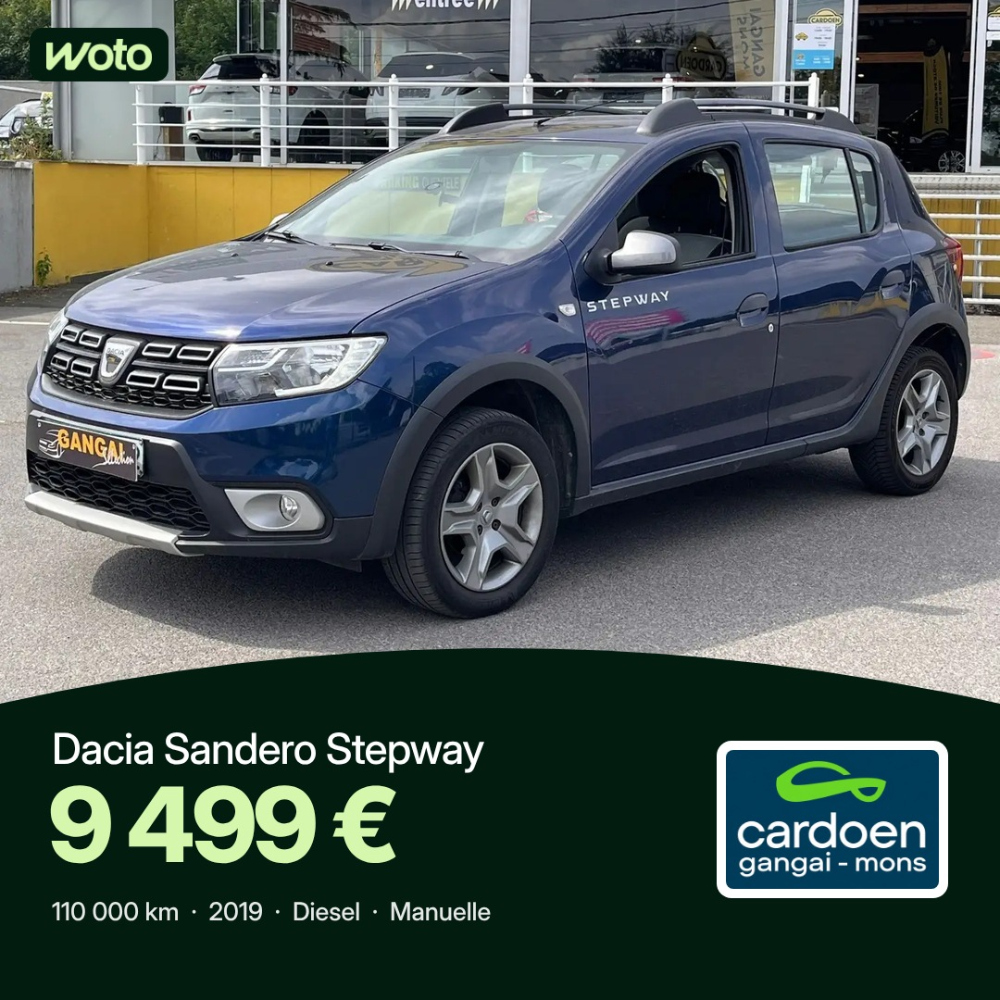

# Projet 2 : publications annonces Woto (fil Facebook et Instagram)

Séparé du projet 1 (stories, voir README.md). Heures de Bruxelles : 7h30 et 17h, programmées 48 h à l'avance.
Gabarit B validé par Vincent le 6 novembre 2026 : Facebook 1080 × 1080, Instagram 1080 × 1350 (`scripts/render_post.py`).

> État : visuels prêts, **pas encore programmés dans Meta**. Meta Business Suite ne permet pas de programmer un premier commentaire : décision de Vincent attendue.

## Samedi 7 novembre

| 7h30 | 17h |
|---|---|
|  |  |
| Maserati Levante, BCS Franzese | Lancia Ypsilon, Auto Vedette & Fils |

## Dimanche 8 novembre

| 7h30 | 17h |
|---|---|
|  |  |
| Fiat Punto Evo, Wattiez Motors | Dacia Sandero Stepway, Cardoen Mons |
