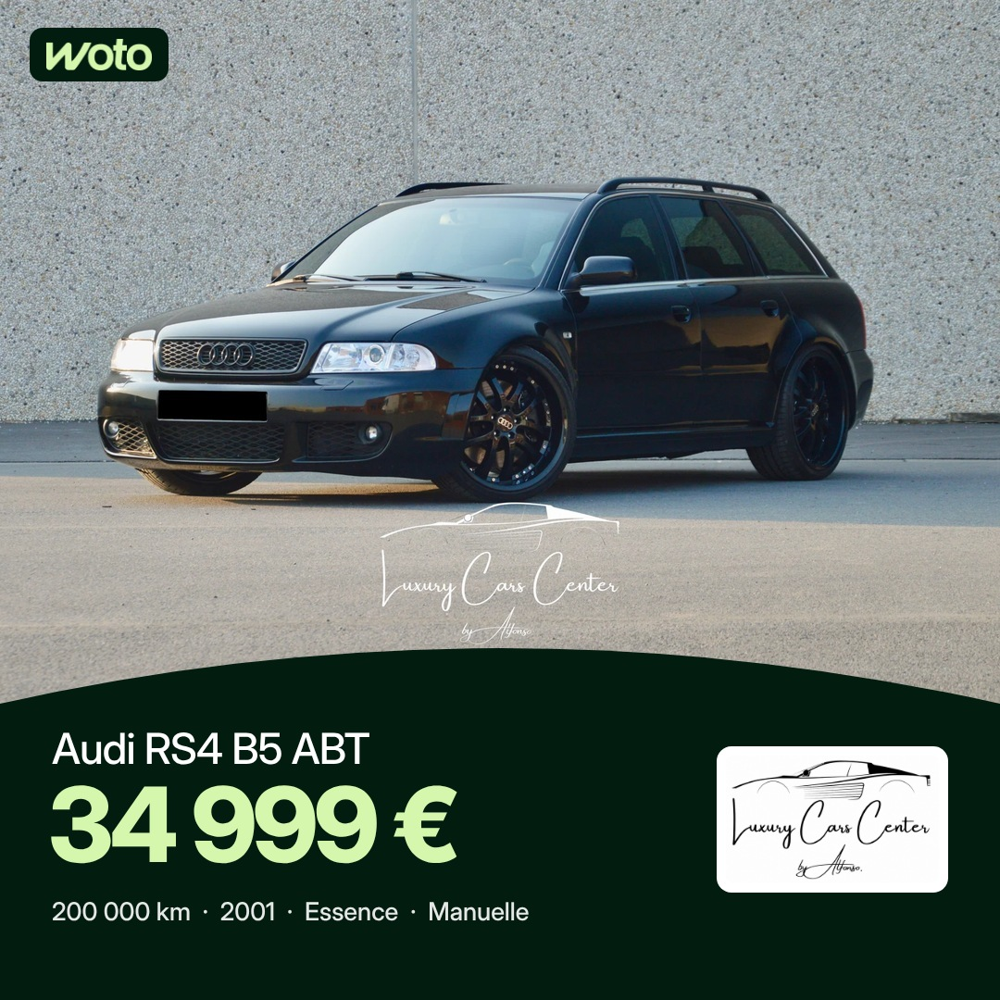

# Projet 2 : publications annonces Woto (fil Facebook et Instagram)

Séparé du projet 1 (stories, voir README.md). Heures de Bruxelles : 7h30 et 17h, programmées 48 h à l'avance. Règles : [RULES-POSTS.md](RULES-POSTS.md).
Facebook 1080 × 1080, Instagram 1080 × 1350. Premier commentaire posté à 7h35 (avec @followers sur Facebook) et 17h05.

## Mardi 10 novembre (7h30 sortie)

| 17h |
|---|
|  |
| Mercedes-Benz GLC 250 d, Mons Automobiles (28 999 €) |

## Mercredi 11 novembre

| 7h30 | 17h |
|---|---|
|  |  |
| Mercedes-AMG A 35, Garage des Chaufours (28 999 €) | Audi RS4 B5 ABT, Luxury Cars Center By Alfonso (34 999 €) |

## Jeudi 12 novembre — ⚠️ PAS ENCORE PROGRAMMÉ

Visuels prêts, mais la programmation est bloquée : le dossier Mac `Woto Stories` (Bureau) est introuvable. Il est toujours connecté à la tâche mais n'existe plus à cet emplacement (déplacé ou renommé ?).

| 7h30 | 17h |
|---|---|
|  |  |
| Mercedes-Benz GLA 180 d, Salaz Motors (31 490 €) | ~~Volkswagen T-Cross, Cardoen Mons~~ **annulé** : déjà en story le 12/11 à 7h30. Autre voiture à choisir. |
