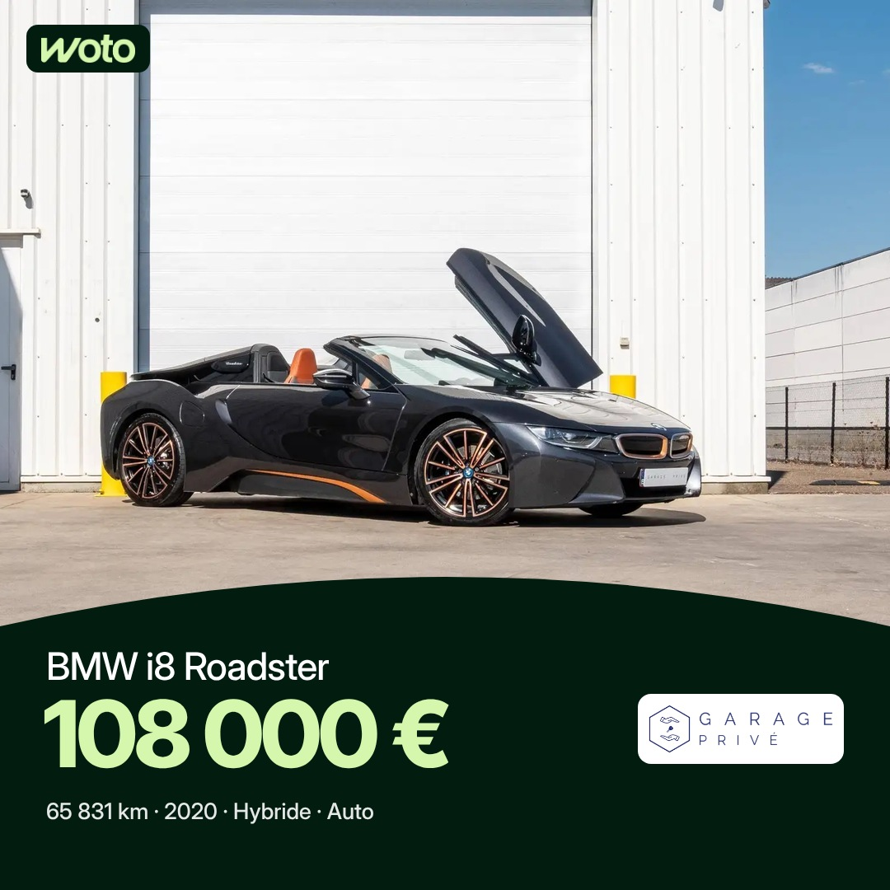
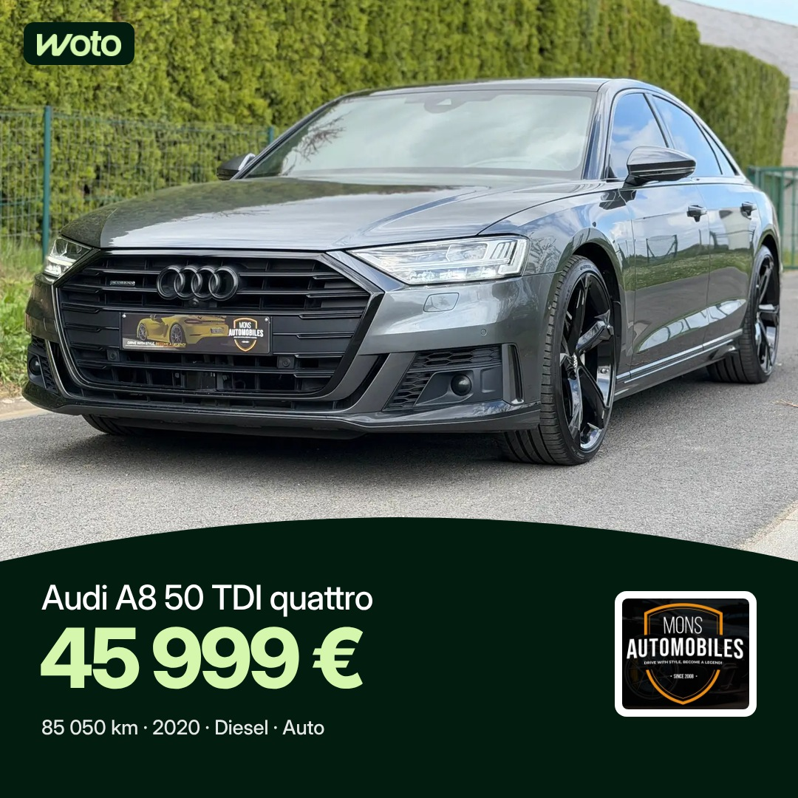
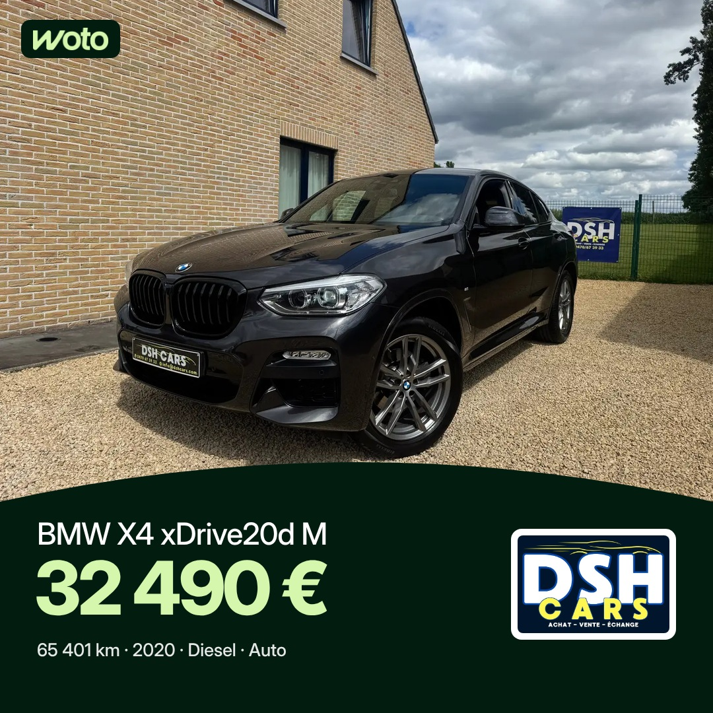
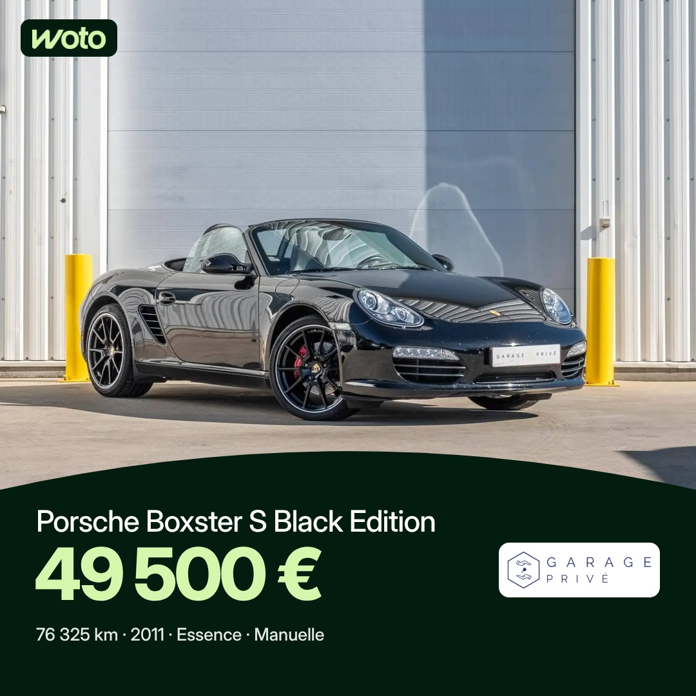

# Projet 2 : publications annonces Woto (fil Facebook et Instagram)

Séparé du projet 1 (stories, voir README.md). Heures de Bruxelles : 7h30 et 17h, programmées 48 h à l'avance. Règles : [RULES-POSTS.md](RULES-POSTS.md).
Facebook 1080 × 1080, Instagram 1080 × 1350. Premier commentaire posté à 7h35 (avec @followers sur Facebook) et 17h05.

## Mardi 17 novembre (7h30 sortie : BMW 116d, PP Auto)

| 17h |
|---|
|  |
| BMW i8 Roadster, Garage Privé Wavre (108 000 €) |

## Mercredi 18 novembre

| 7h30 | 17h |
|---|---|
|  |  |
| Audi A8 50 TDI quattro, Mons Automobiles (45 999 €) | Audi Q3 35 TDI, Salaz Motors (23 990 €) |

## Jeudi 19 novembre

| 7h30 | 17h |
|---|---|
|  |  |
| BMW X4 xDrive20d M, DSH Cars (32 490 €) | Porsche Boxster S Black Edition, Garage Privé Wavre (49 500 €) |
