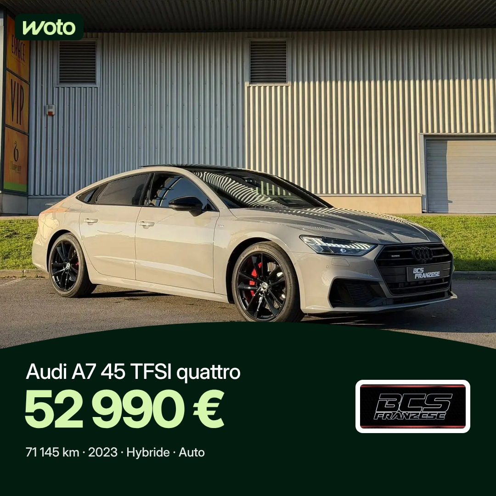

# Projet 2 : publications annonces Woto (fil Facebook et Instagram)

Séparé du projet 1 (stories, voir README.md). Heures de Bruxelles : 7h30 et 17h, programmées 48 h à l'avance. Règles : [RULES-POSTS.md](RULES-POSTS.md).
Facebook 1080 × 1080, Instagram 1080 × 1350. Premier commentaire posté à 7h35 (avec @followers sur Facebook) et 17h05.

## Mercredi 11 novembre (7h30 sortie)

| 17h |
|---|
|  |
| Audi RS4 B5 ABT, Luxury Cars Center By Alfonso (34 999 €) |

## Jeudi 12 novembre

GLA rattrapée : publiée à 7h42 (Facebook) et 7h44 (Instagram), premier commentaire posté. Créneau 17h à remplir par la tâche de 9h47.

| 7h30 | 17h |
|---|---|
|  | — |
| Mercedes-Benz GLA 180 d, Salaz Motors (31 490 €) — publiée 7h42/7h44 | vide |

## Vendredi 13 novembre

| 7h30 | 17h |
|---|---|
|  |  |
| Porsche Panamera 4S, Garage des Chaufours (74 999 €) | Audi A7 45 TFSI quattro, BCS Franzese (52 990 €) |
