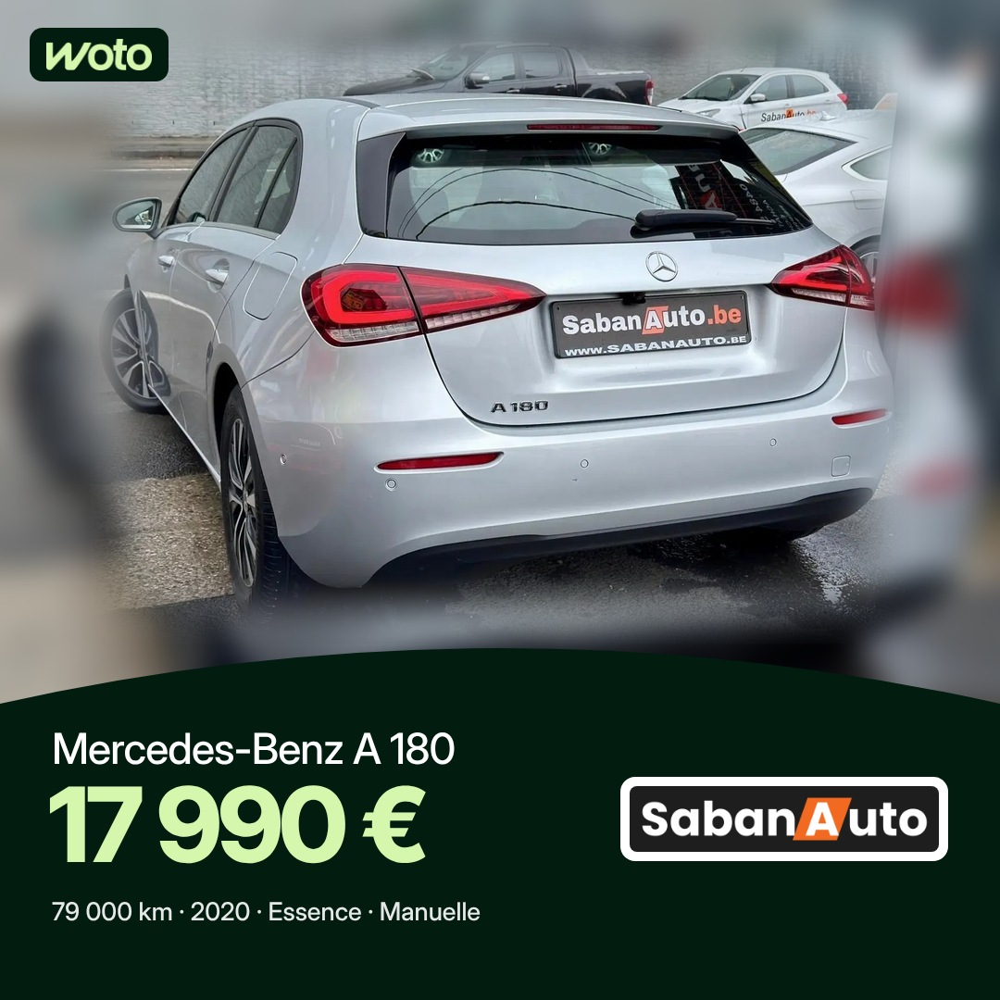
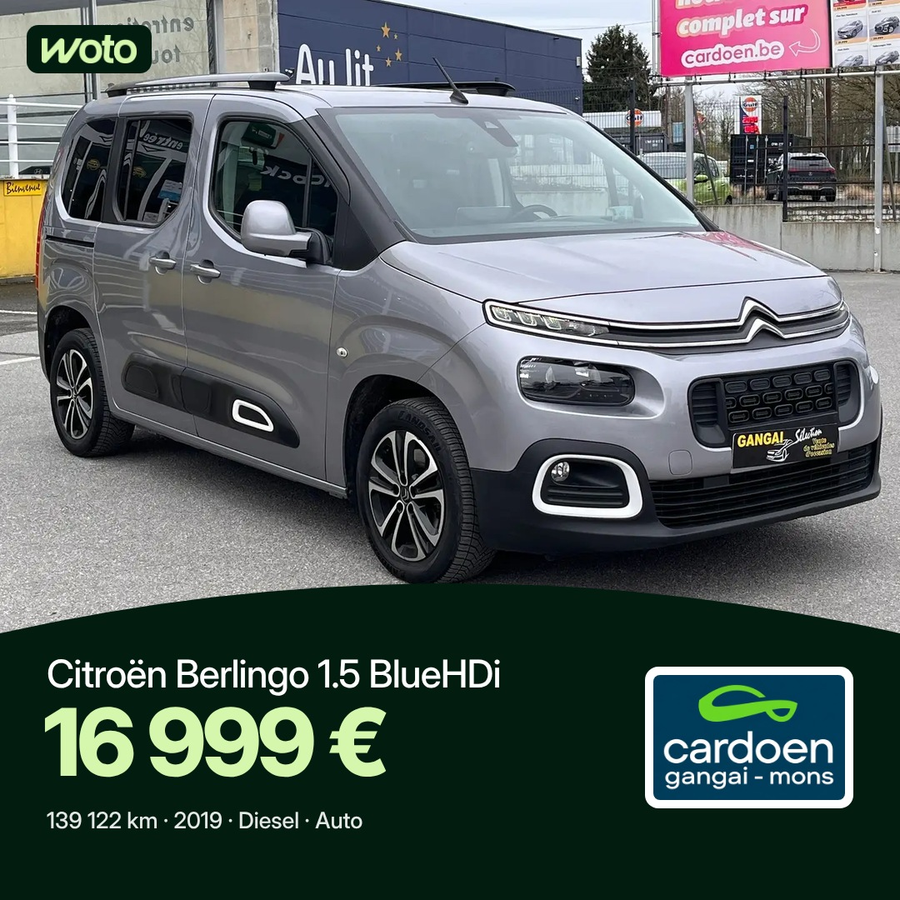
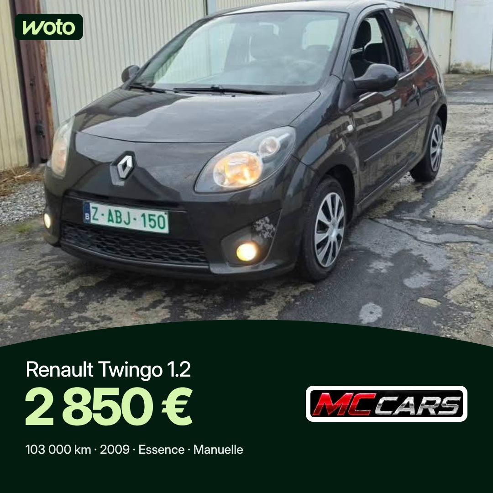
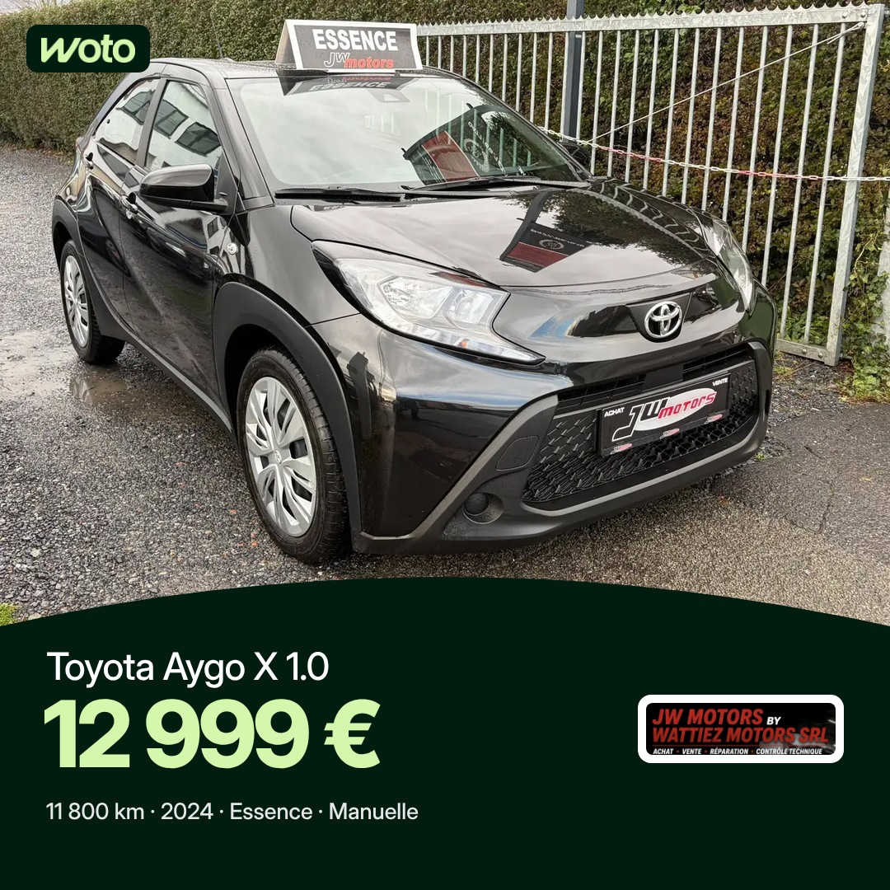

# Projet 2 : publications annonces Woto (fil Facebook et Instagram)

Séparé du projet 1 (stories, voir README.md). Heures de Bruxelles : 7h30, 12h15, 17h00, 19h30 et 21h30, programmées 48 h à l'avance. Règles : [RULES-POSTS.md](RULES-POSTS.md).
Facebook 1080 × 1080, Instagram 1080 × 1350. Premier commentaire posté à 7h35 (avec @followers sur Facebook), 12h35, 17h35, 19h35 et 21h35.

## Jeudi 26 novembre

7h30 sorti (Mercedes-Benz A 180). 12h15 et les suivants programmés :

| 7h30 (sortie) | 12h15 | 17h | 19h30 | 21h30 |
|---|---|---|---|---|
|  |  |  |  |  |
| Mercedes-Benz A 180, SabanAuto Quaregnon (17 990 €) | Renault Trafic VIP 2.0 dCi, Luxury Cars Center By Alfonso (50 000 €, boucle) | Lancia Ypsilon 1.2, Auto Vedette & Fils (4 990 €, boucle) | Citroën Berlingo 1.5 BlueHDi, Cardoen Mons (16 999 €, boucle) | BMW M135i xDrive, Garage Privé Wavre (45 000 €) |

## Vendredi 27 novembre

| 7h30 | 12h15 | 17h | 19h30 | 21h30 |
|---|---|---|---|---|
|  |  |  |  |  |
| Renault Twingo 1.2, MC Cars (2 850 €) | Toyota Aygo X 1.0, Wattiez Motors (12 999 €) | Kia Ceed 1.0 T-GDi Pulse, Grs Auto (14 990 €) | Range Rover Evoque 2.0 TD4, Salaz Motors (12 990 €) | Nissan X-Trail e-Power, DSH Cars (25 990 €) |

## Samedi 28 novembre

| 7h30 | 12h15 | 17h | 19h30 | 21h30 |
|---|---|---|---|---|
|  |  |  |  |  |
| Audi Q3 Sportback 1.5 TFSI S line, Garage des Chaufours (45 999 €) | Kia Sportage 1.6 T-GDi GT Line, Kia - La Louvière Motors (26 490 €) | Maserati Levante GranSport, BCS Franzese (49 990 €, boucle) | Mercedes-Benz CLA 200, SabanAuto Quaregnon (20 990 €) | BMW X5 xDrive30d Pack M, Mons Automobiles (19 499 €) |
