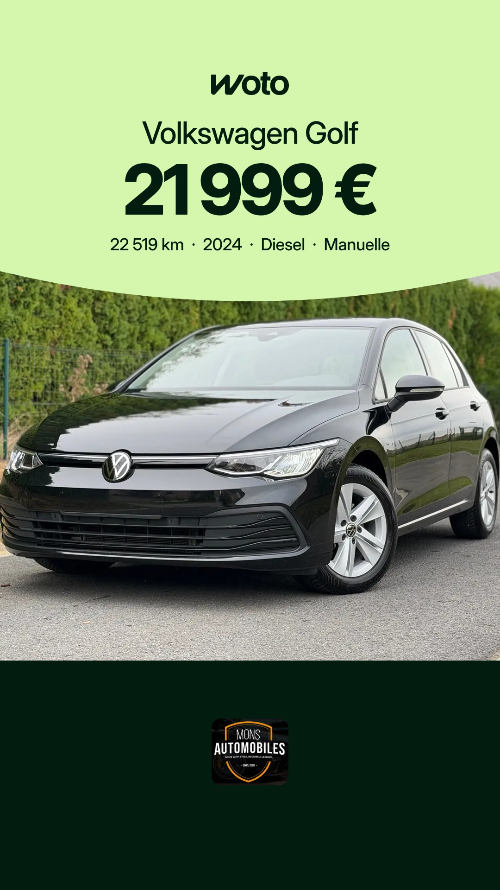
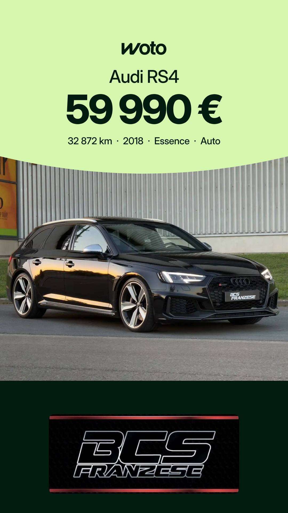
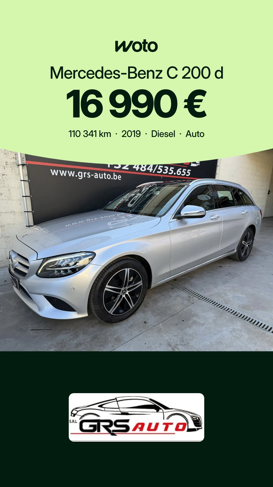

# Planning des stories Woto

Mis à jour chaque matin. Heures de Bruxelles. Sur chaque story, Facebook et Instagram : bouton « Voir l'annonce → ».

## Mardi 17 novembre

| 7h30 (publiée) | 16h | 20h |
|---|---|---|
|  |  |  |
| Volkswagen Transporter, SabanAuto Quaregnon | Volkswagen Golf, Mons Automobiles | Audi Q3, Garage Privé Wavre |

## Mercredi 18 novembre

| 7h30 | 16h | 20h |
|---|---|---|
|  |  |  |
| Audi RS4, BCS Franzese | Ford Kuga, Wattiez Motors | Mercedes-Benz C 200 d, Grs Auto |

Règles : [RULES.md](RULES.md)
