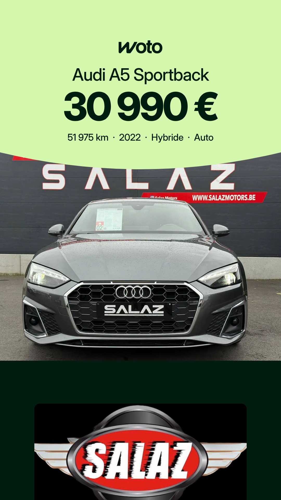
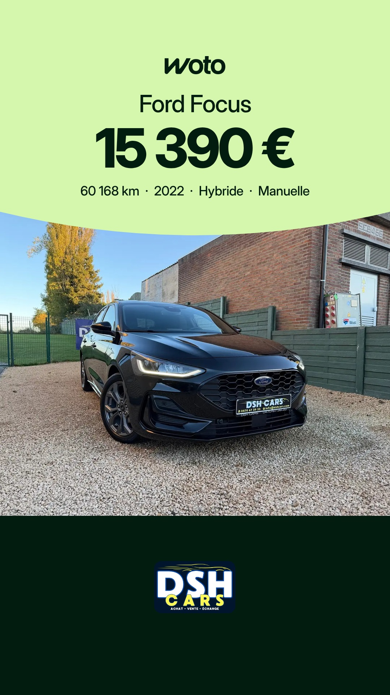
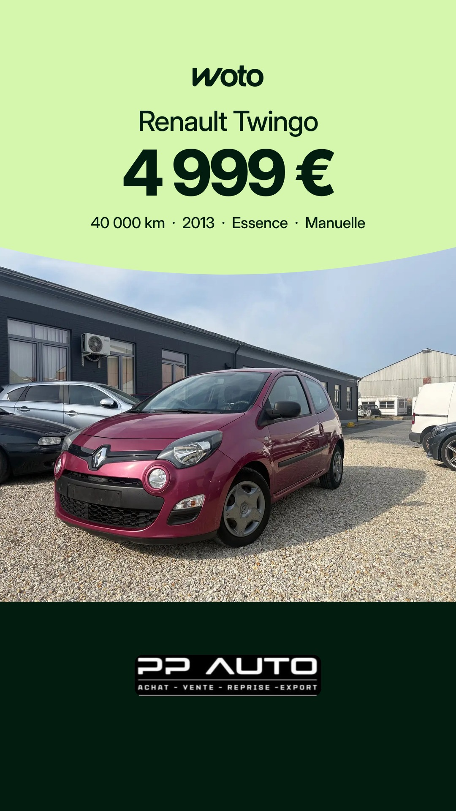

# Planning des stories Woto

Mis à jour chaque matin. Heures de Bruxelles. Sur chaque story, Facebook et Instagram : bouton « Voir l'annonce → ».

## Mercredi 18 novembre

| 7h30 (publiée) | 16h | 20h |
|---|---|---|
|  |  |  |
| Audi RS4, BCS Franzese | Ford Kuga, Wattiez Motors | Mercedes-Benz C 200 d, Grs Auto |

## Jeudi 19 novembre

⚠️ Chrome s'est déconnecté pendant la programmation. La story de 7h30 n'a pas pu être vérifiée dans l'agenda. Celles de 16h et 20h sont prêtes mais pas programmées.

| 7h30 (à vérifier) | 16h (pas programmée) | 20h (pas programmée) |
|---|---|---|
|  |  |  |
| Audi A5 Sportback, Salaz Motors | Ford Focus, DSH Cars | Renault Twingo, PP Auto |

Règles : [RULES.md](RULES.md)
