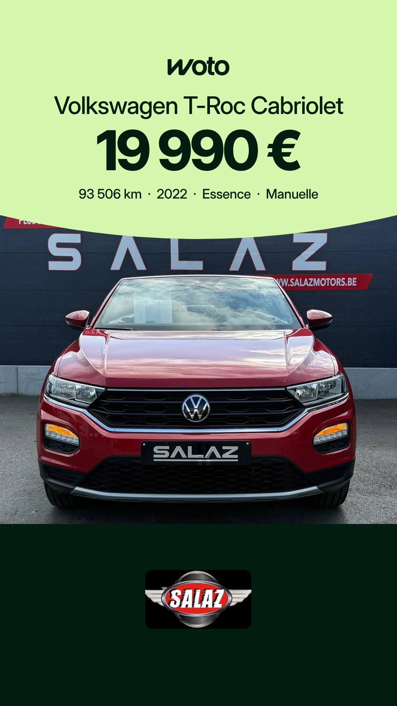

# Planning des stories Woto

Mis à jour chaque matin. Heures de Bruxelles. Sur chaque story, Facebook et Instagram : bouton « Voir l'annonce → ».

## Dimanche 8 novembre

| 16h | 20h |
|---|---|
|  |  |
| BMW 318d, Grs Auto | Volkswagen Golf Sportsvan, Auto Vedette & Fils |

## Lundi 9 novembre

| 7h30 | 16h | 20h |
|---|---|---|
|  |  |  |
| Volkswagen T-Roc Cabriolet, Salaz Motors | Fiat 500C Abarth, Wattiez Motors | Volkswagen Tiguan, Garage des Chaufours |

Règles : [RULES.md](RULES.md)
