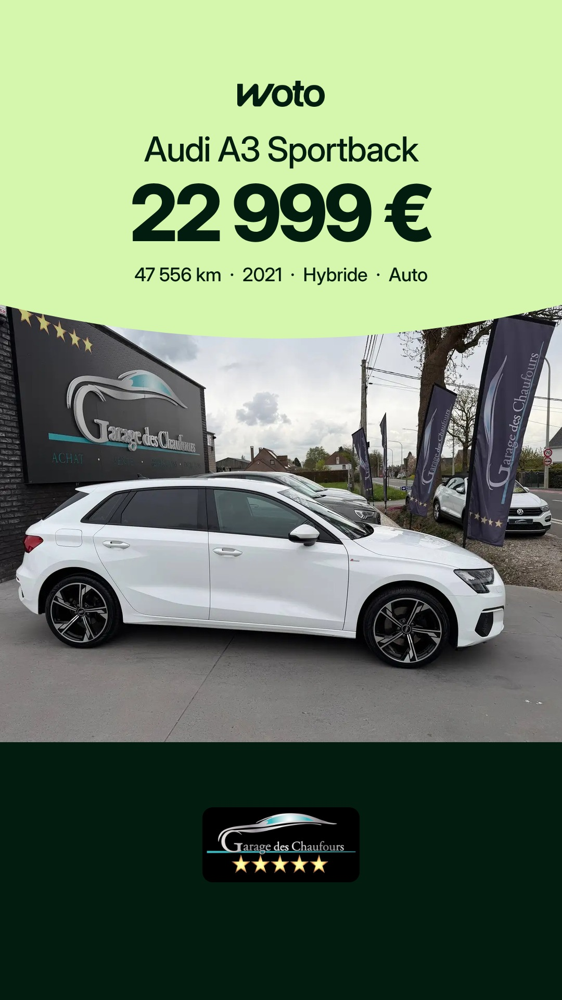
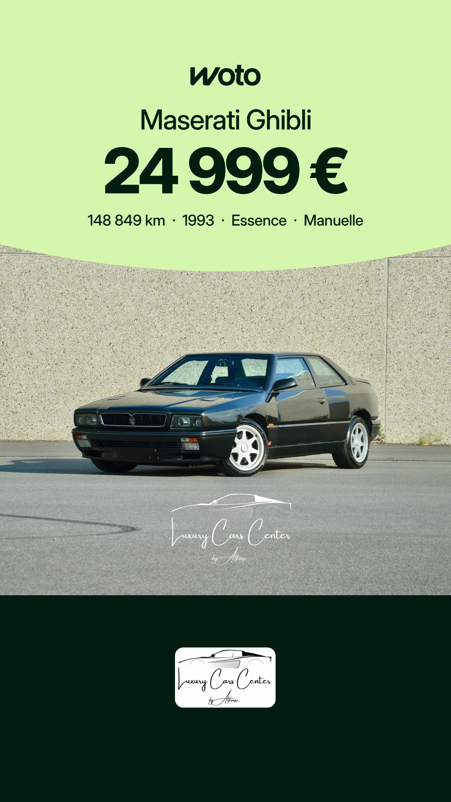

# Planning des stories Woto

Mis à jour chaque matin. Heures de Bruxelles. Sur chaque story, Facebook et Instagram : bouton « Voir l'annonce → ».

## Jeudi 5 novembre

| 16h | 20h |
|---|---|
|  |  |
| Citroën Berlingo, Wattiez Motors | Audi A3 Sportback, Garage des Chaufours |

## Vendredi 6 novembre

| 7h30 | 16h | 20h |
|---|---|---|
|  |  |  |
| Citroën Berlingo, Cardoen Mons | Maserati Ghibli, Luxury Cars Center By Alfonso | Honda HR-V, Mons Automobiles |

Règles : [RULES.md](RULES.md)
