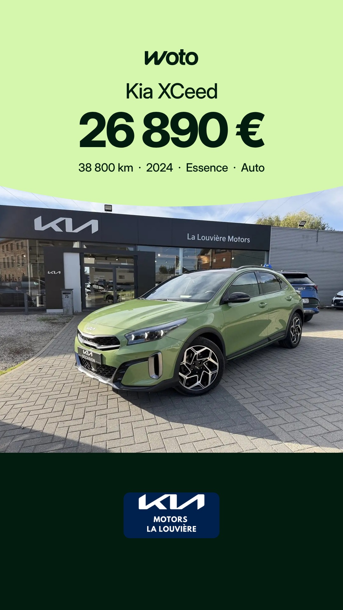
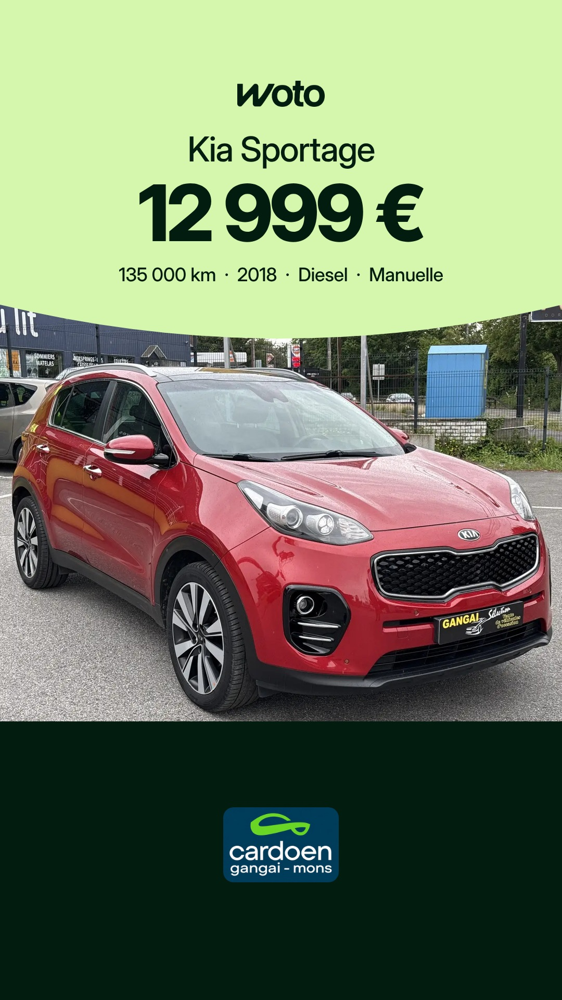
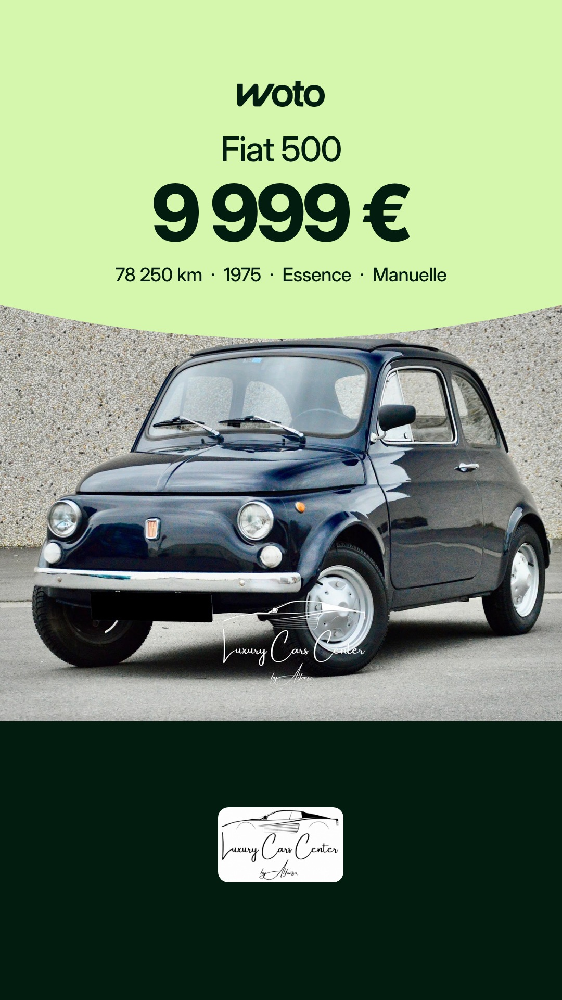
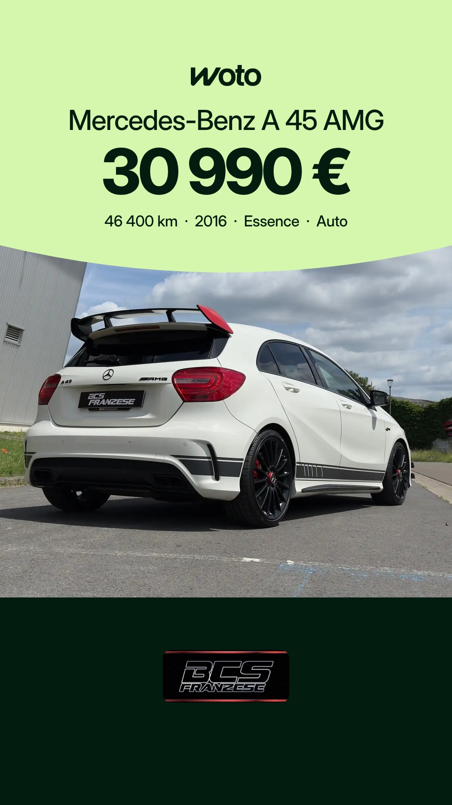
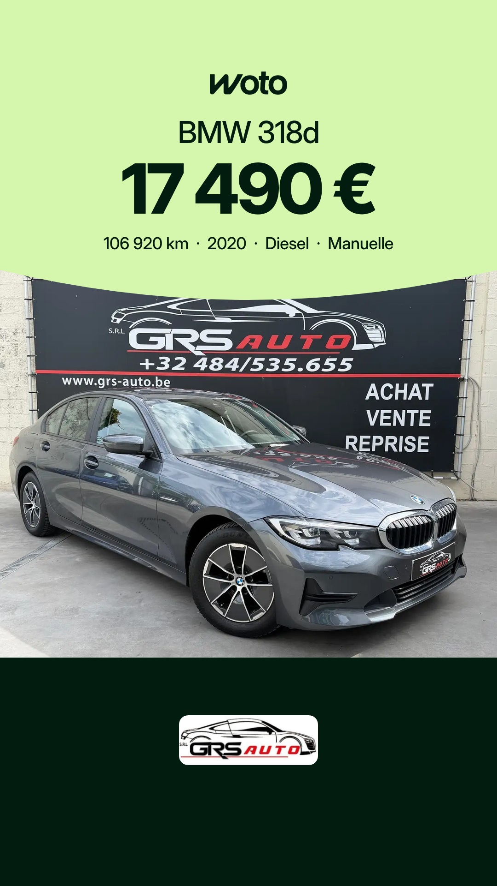
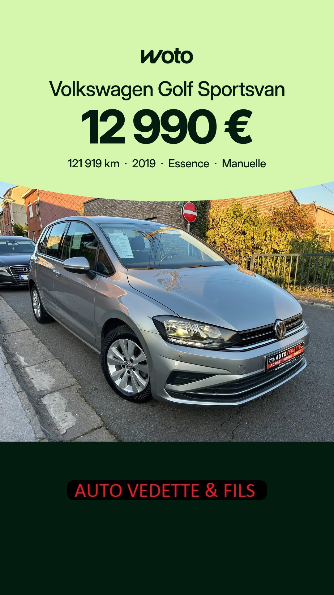

# Planning des stories Woto

Mis à jour chaque matin. Heures de Bruxelles. Sur chaque story, Facebook et Instagram : bouton « Voir l'annonce → ».

## Samedi 7 novembre

| 7h30 | 16h | 20h |
|---|---|---|
|  |  |  |
| Kia XCeed, Kia - La Louvière Motors | Kia Sportage, Cardoen Mons | Fiat 500, Luxury Cars Center By Alfonso |

## Dimanche 8 novembre

| 7h30 | 16h | 20h |
|---|---|---|
|  |  |  |
| Mercedes-Benz A 45 AMG, BCS Franzese | BMW 318d, Grs Auto | Volkswagen Golf Sportsvan, Auto Vedette & Fils |

Règles : [RULES.md](RULES.md)
