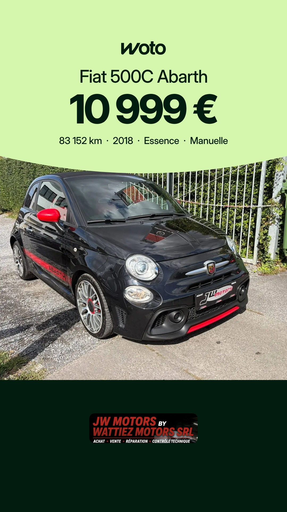
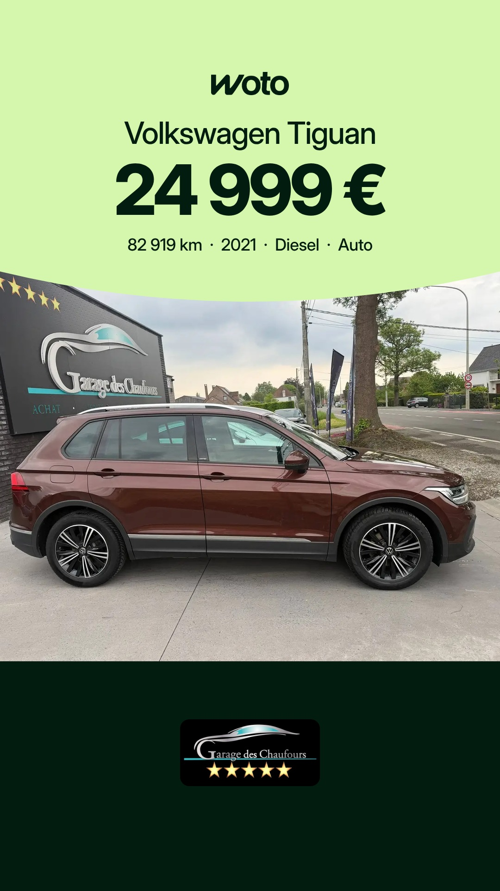
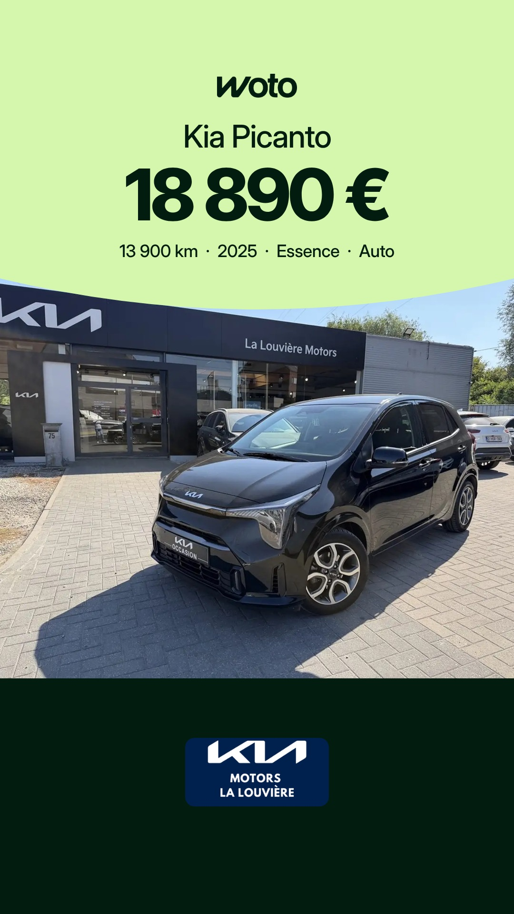
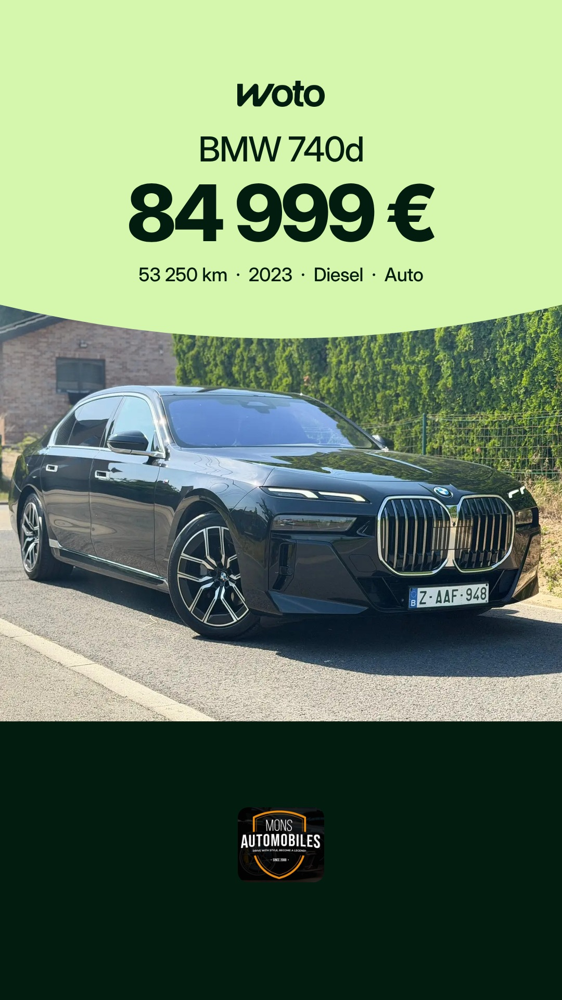
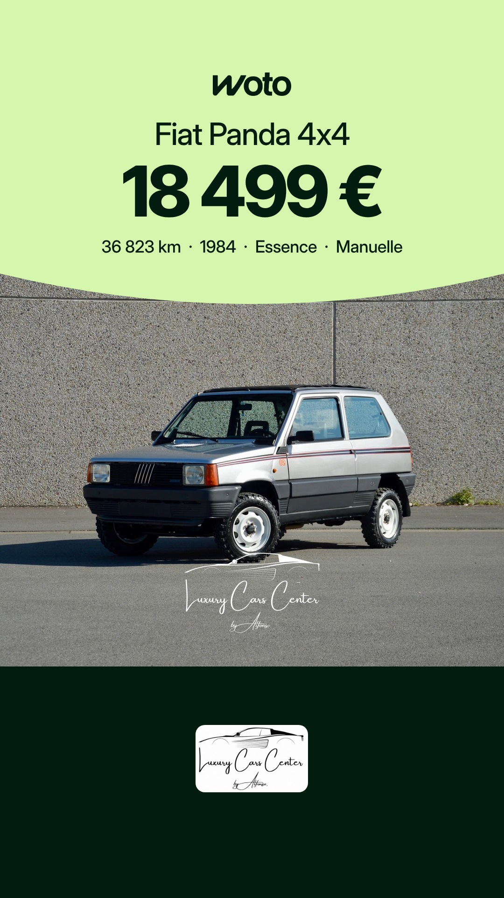

# Planning des stories Woto

Mis à jour chaque matin. Heures de Bruxelles. Sur chaque story, Facebook et Instagram : bouton « Voir l'annonce → ».

## Lundi 9 novembre

| 16h | 20h |
|---|---|
|  |  |
| Fiat 500C Abarth, Wattiez Motors | Volkswagen Tiguan, Garage des Chaufours |

## Mardi 10 novembre

| 7h30 | 16h | 20h |
|---|---|---|
|  |  |  |
| Kia Picanto, Kia - La Louvière Motors | BMW 740d, Mons Automobiles | Fiat Panda 4x4, Luxury Cars Center By Alfonso |

Règles : [RULES.md](RULES.md)
