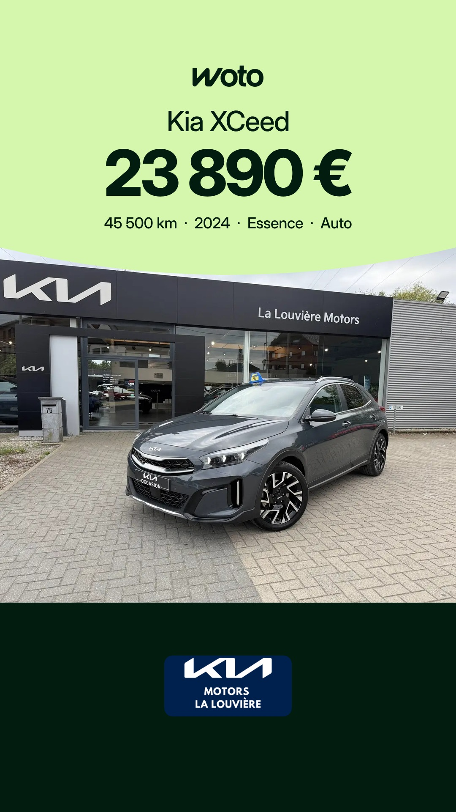

# Planning des stories Woto

Mis à jour chaque matin. Heures de Bruxelles. Sur chaque story, Facebook et Instagram : bouton « Voir l'annonce → ».

## Samedi 21 novembre

7h30 publiée (Hyundai Kona, Grs Auto), active sur Facebook et Instagram dans l'agenda Meta.

| 16h | 20h |
|---|---|
|  |  |
| Kia XCeed, Kia - La Louvière Motors | Volvo S90, Garage Privé Wavre |

## Dimanche 22 novembre

| 7h30 | 16h | 20h |
|---|---|---|
|  |  |  |
| Volkswagen Tiguan, SabanAuto Quaregnon | Volkswagen Golf Variant, Salaz Motors | Kia Sportage, Kia - La Louvière Motors |

Règles : [RULES.md](RULES.md)
