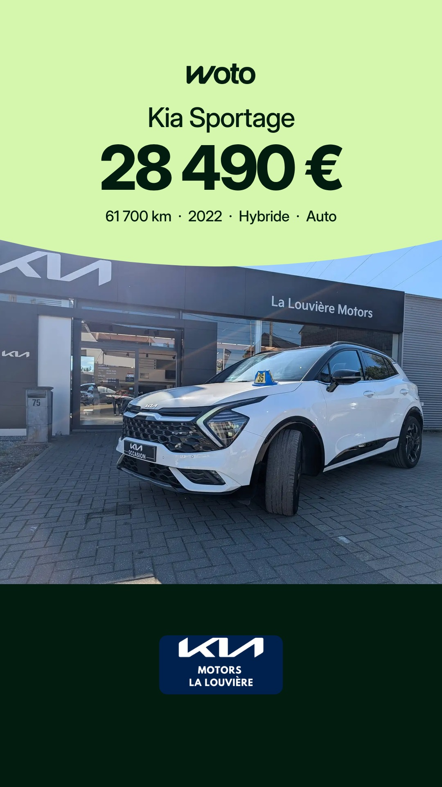
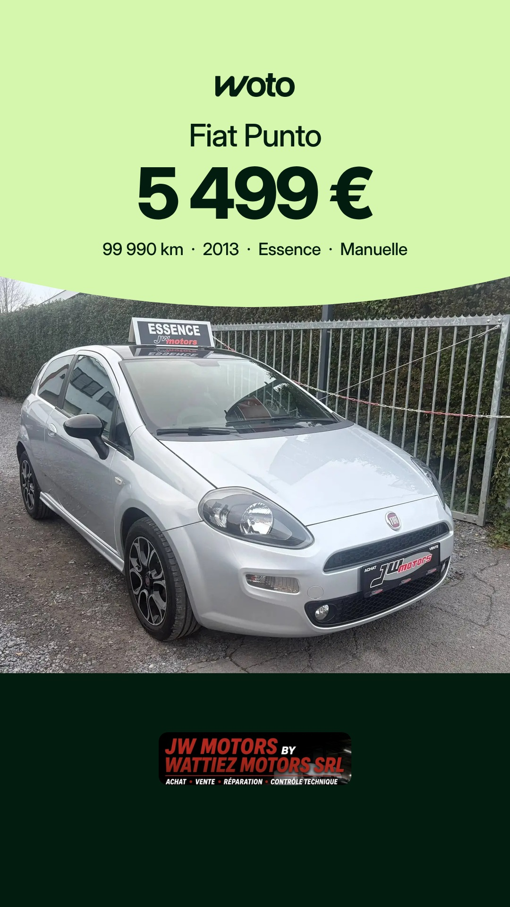

# Planning des stories Woto

Mis à jour chaque matin. Heures de Bruxelles. Sur chaque story, Facebook et Instagram : bouton « Voir l'annonce → ».

## Dimanche 22 novembre

7h30 publiée (Volkswagen Tiguan, SabanAuto Quaregnon), active sur Facebook et Instagram dans l'agenda Meta.

| 16h | 20h |
|---|---|
|  |  |
| Volkswagen Golf Variant, Salaz Motors | Kia Sportage, Kia - La Louvière Motors |

## Lundi 23 novembre

| 7h30 | 16h | 20h |
|---|---|---|
|  |  |  |
| Fiat Punto, Wattiez Motors | Volkswagen T7 Transporter, Mons Automobiles | Audi A5, DSH Cars |

Règles : [RULES.md](RULES.md)
