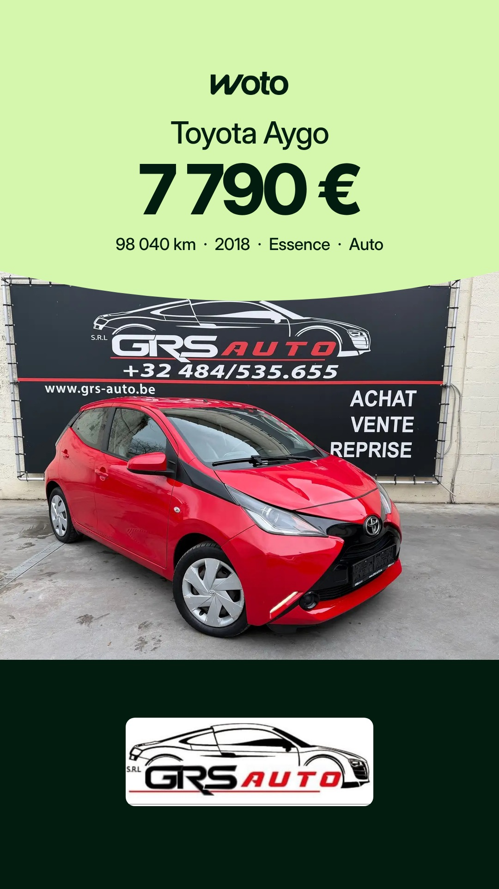
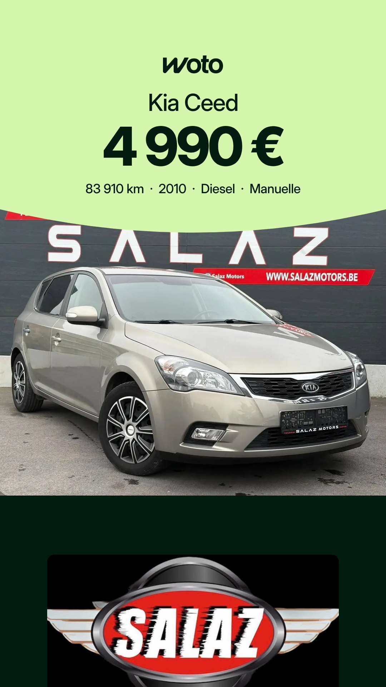
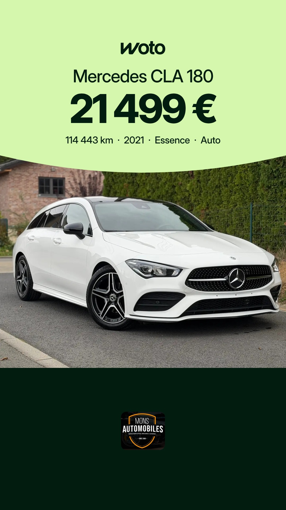
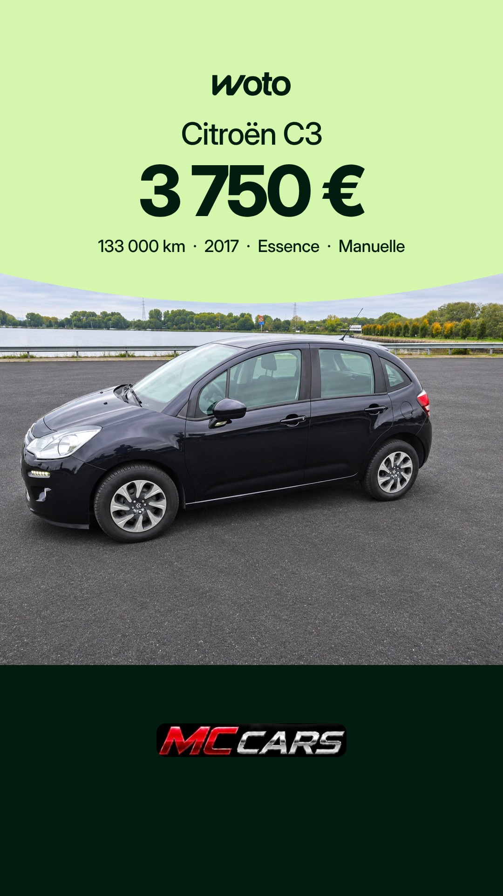
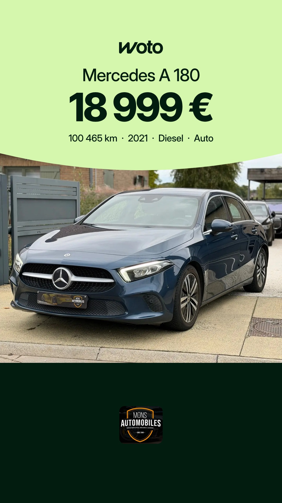
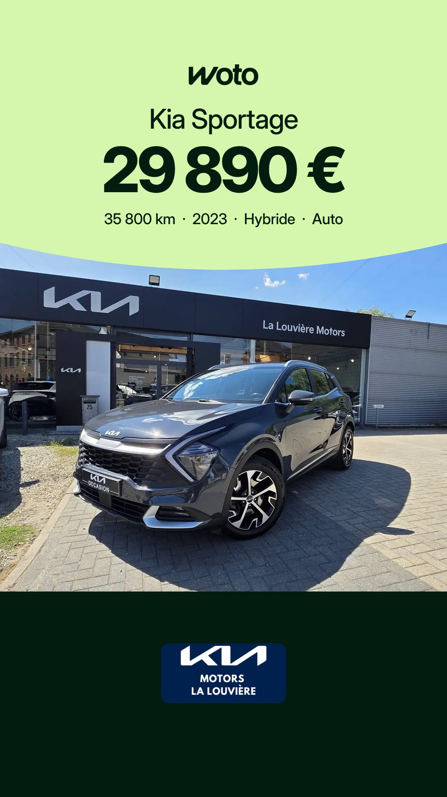
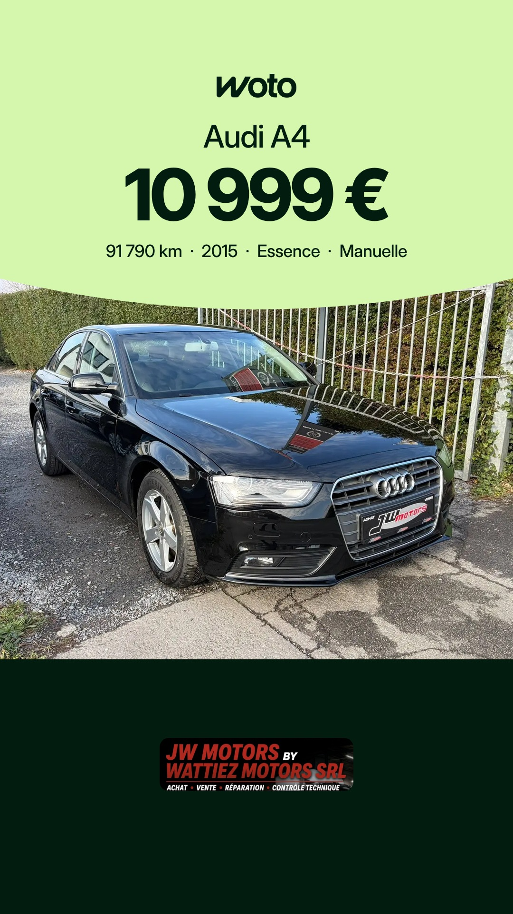
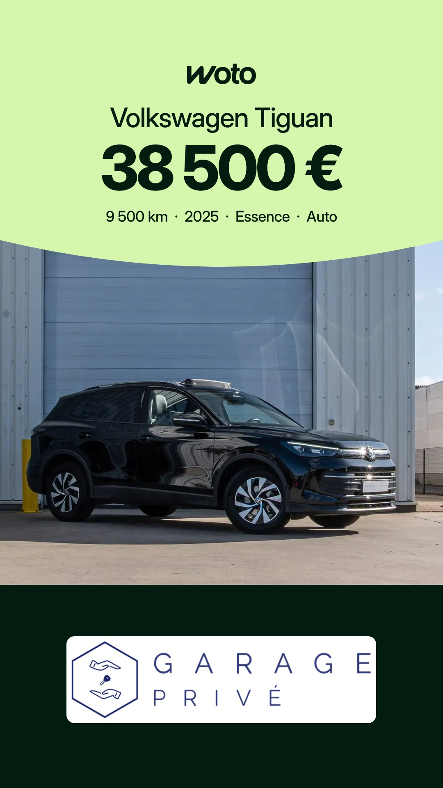
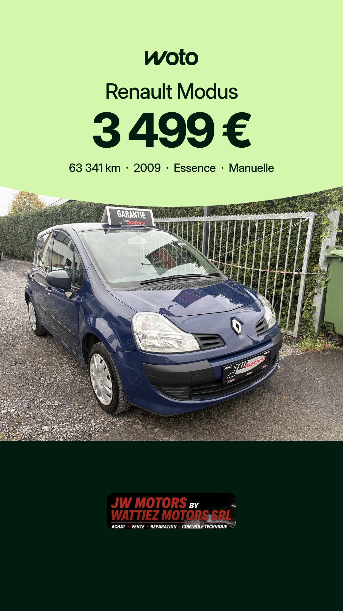
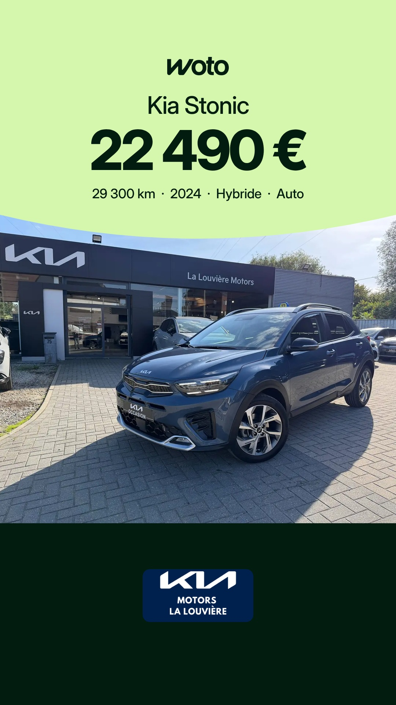

# Planning des stories Woto

Mis à jour à chaque passage. Heures de Bruxelles. Sur chaque story, Facebook et Instagram : sticker « Voir l'annonce → ».

## Jeudi 26 novembre

Sorties : 7h30 Seat Ibiza (MC Cars), 9h00 Kia XCeed, 10h30 Audi S3, 12h00 Hyundai i20, 13h30 Peugeot 3008. À venir :

| 15h00 | 16h30 | 18h00 | 19h30 | 21h00 |
|---|---|---|---|---|
|  |  |  |  |  |
| Toyota Aygo, Grs Auto ⚠️ vendue sur Woto (scan 14h15), toujours programmée | Kia Ceed, Salaz Motors | Mercedes CLA 180, Mons Automobiles | Citroën C3, MC Cars | Toyota Proace, Garage Privé Wavre |

## Vendredi 27 novembre

| 7h30 | 9h00 | 10h30 | 12h00 | 13h30 |
|---|---|---|---|---|
|  |  |  |  |  |
| Mercedes A 180, Mons Automobiles | Volkswagen Taigo, Salaz Motors | Kia Sportage, Kia La Louvière | Audi A4, Wattiez Motors | Volkswagen up!, Grs Auto |

| 15h00 | 16h30 | 18h00 | 19h30 | 21h00 |
|---|---|---|---|---|
|  |  |  |  |  |
| Volkswagen Tiguan, Garage Privé Wavre | Renault Modus, Wattiez Motors | Kia Stonic, Kia La Louvière | Volkswagen Golf, Salaz Motors | Hyundai Ioniq 5, Garage Privé Wavre |

Toutes des voitures jamais montrées (pas de boucle). MC Cars sauté : les deux Suzuki Alto ont la voiture coupée sur toutes les photos (et une galerie mélangée). Mons : Seat Ibiza et C5 Aircross écartés (photos trop serrées), Picanto, X1 et Trafic écartés (galeries mélangées avec d'autres garages), BMW X5 écarté (offre réservée aux marchands). SabanAuto et Garage des Chaufours toujours sautés.

Passage de 14h12 : scan 347 fiches au stock (+31 motos sans données), nouveau garage Ryan Khemir (6 Mercedes) ajouté à `garages.json`, prioritaire pour le 28/11. Aucun doublon avec les publications.

Règles : [RULES.md](RULES.md)
