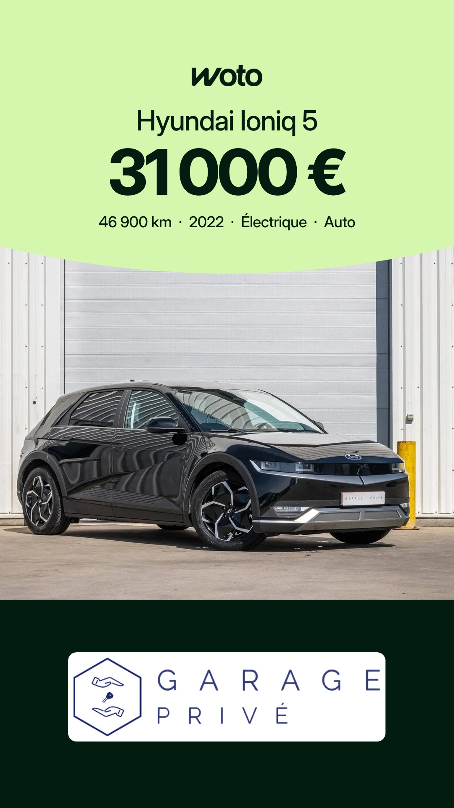
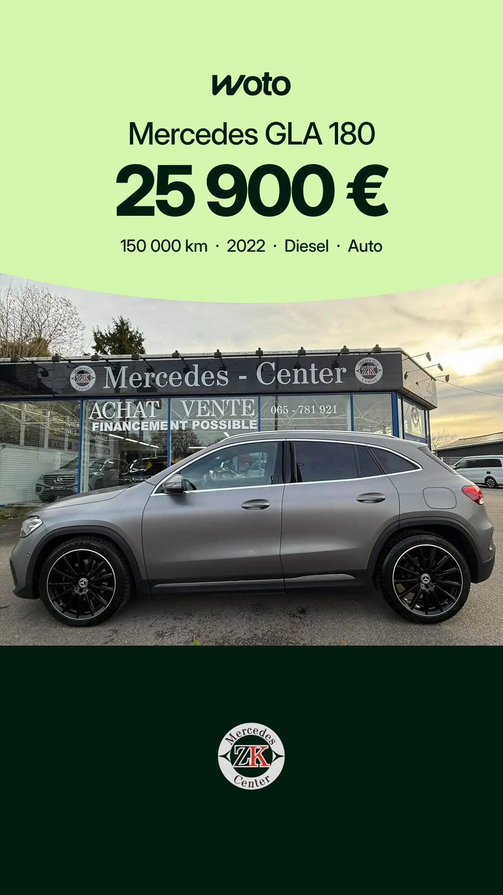
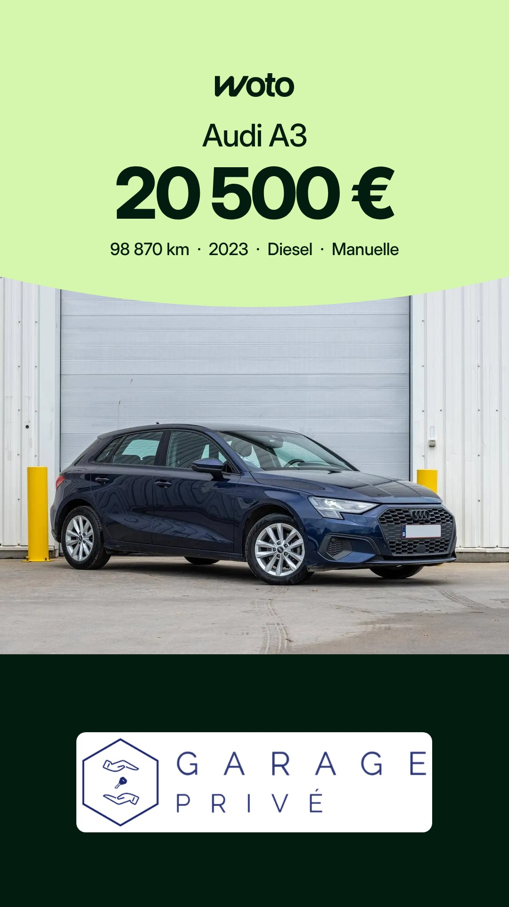
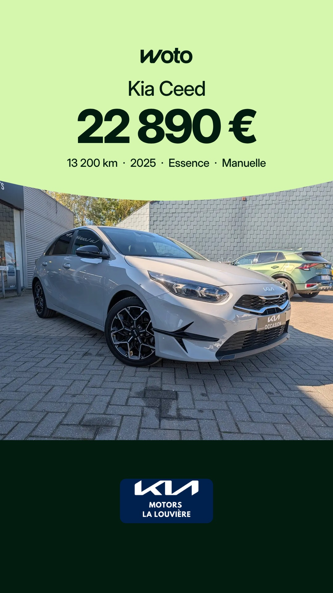
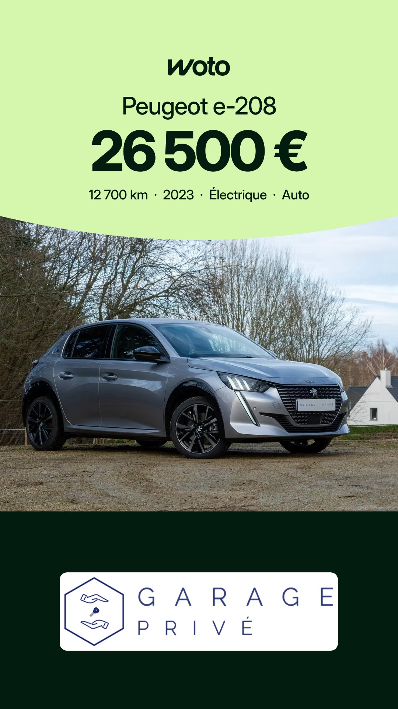

# Planning des stories Woto

Mis à jour à chaque passage. Heures de Bruxelles. Sur chaque story, Facebook et Instagram : sticker « Voir l'annonce → ».

## Vendredi 27 novembre

Sorties : 7h30 Mercedes A 180 (Mons Automobiles), 9h00 Volkswagen Taigo (Salaz Motors), 10h30 Kia Sportage (Kia La Louvière), 12h00 Audi A4 (Wattiez Motors), 13h30 Volkswagen up! (Grs Auto). À venir :

| 15h00 | 16h30 | 18h00 | 19h30 | 21h00 |
|---|---|---|---|---|
|  |  |  |  |  |
| Volkswagen Tiguan, Garage Privé Wavre | Renault Modus, Wattiez Motors | Kia Stonic, Kia La Louvière | Volkswagen Golf, Salaz Motors | Hyundai Ioniq 5, Garage Privé Wavre |

## Samedi 28 novembre

| 7h30 | 9h00 | 10h30 | 12h00 | 13h30 |
|---|---|---|---|---|
|  |  |  |  |  |
| Mercedes GLA 180, Ryan Khemir (nouveau garage) | Kia Stonic, Kia La Louvière | Opel Astra, Wattiez Motors | BMW 218, Garage Privé Wavre | Mercedes Vito, Wattiez Motors |

| 15h00 | 16h30 | 18h00 | 19h30 | 21h00 |
|---|---|---|---|---|
|  |  |  |  |  |
| Toyota Proace City, Mons Automobiles | Audi A3, Garage Privé Wavre | Kia Ceed, Kia La Louvière | Peugeot e-208, Garage Privé Wavre | Mercedes CLS 220, Ryan Khemir |

Toutes des voitures jamais montrées (pas de boucle). Sautés : Salaz Motors (bandeau Salaz visible sur toutes les photos), SabanAuto (voiture coupée sur toutes les photos), Garage des Chaufours (2e prix « Pour Professionnels »), MC Cars (deux Suzuki Alto, voiture coupée), Luxury Cars (seule fiche : Alfa Giulia 1978 pour pièces). Ryan Khemir : A 200 et E 200 écartées (prix « net » TVA déductible dans la description).

Passage du 27/11 8h12 : scan 372 fiches (30 motos sans données), 16 garages connus, aucun nouveau garage pro, aucun doublon avec les publications, rien à rattraper.

Passage du 27/11 14h12 : scan 372 fiches (30 motos sans données), 16 garages connus, aucun nouveau garage pro ; agenda Meta complet aujourd'hui et demain (10/10), aucun doublon avec les publications, toutes les stories à venir au stock au même prix, rien à rattraper.

Règles : [RULES.md](RULES.md)
