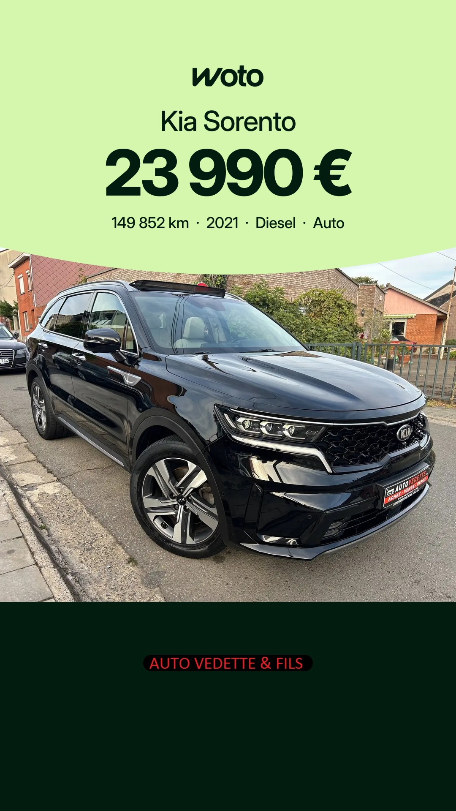
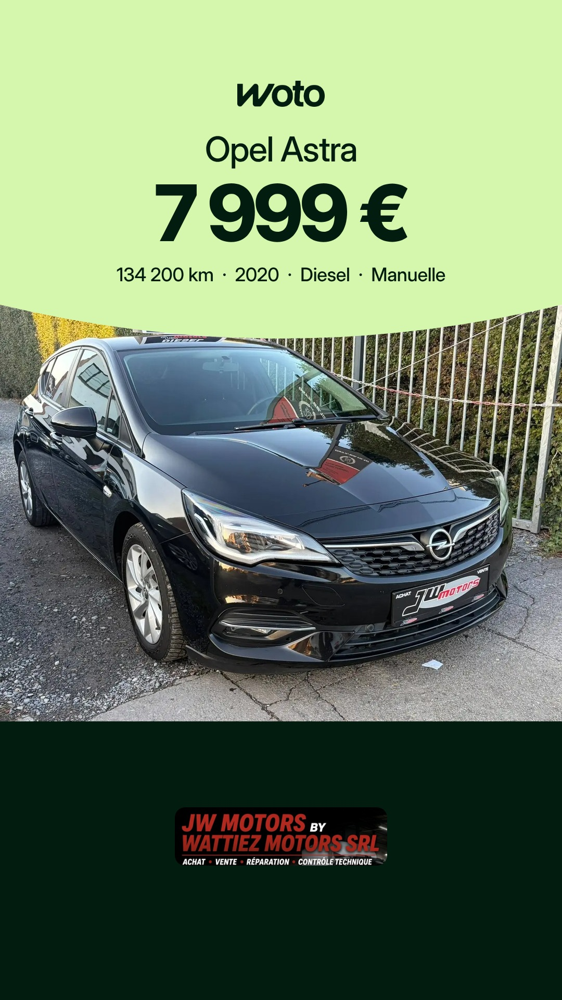

# Planning des stories Woto

Mis à jour chaque matin. Heures de Bruxelles. Sur chaque story, Facebook et Instagram : bouton « Voir l'annonce → ».

## Vendredi 13 novembre

| 7h30 (publiée) | 16h | 20h |
|---|---|---|
|  |  |  |
| Volkswagen Taigo, Salaz Motors | Kia Sorento, Auto Vedette & Fils | Opel Astra, Wattiez Motors |

## Samedi 14 novembre

| 7h30 | 16h | 20h |
|---|---|---|
|  |  |  |
| Mercedes GLC Coupé, Garage Privé Wavre | SEAT Arosa, Garage des Chaufours | BMW 520e, Mons Automobiles |

Règles : [RULES.md](RULES.md)
