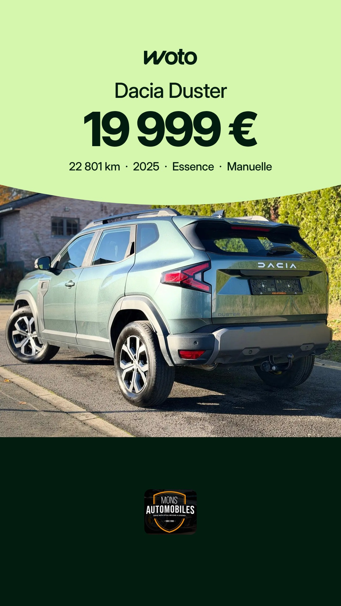
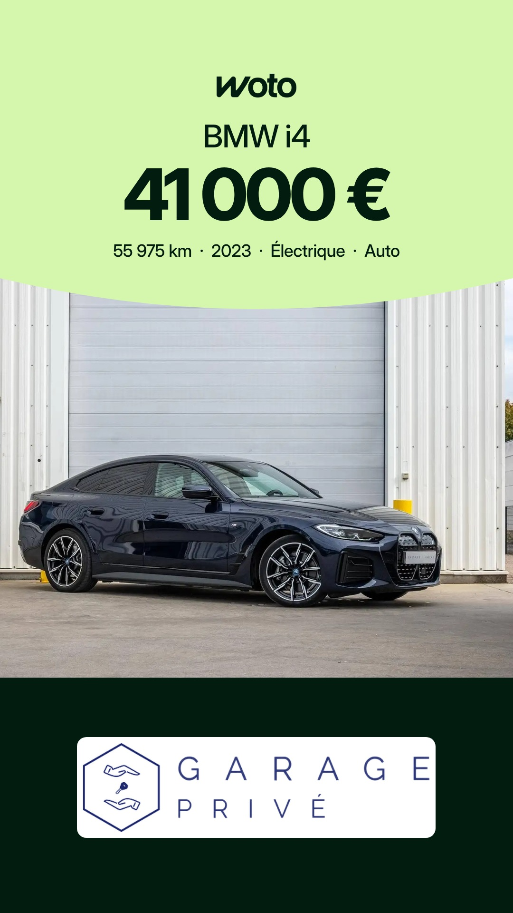
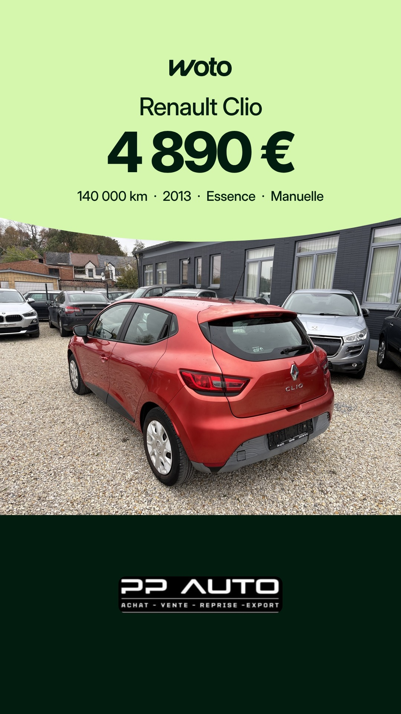

# Planning des stories Woto

Mis à jour à chaque passage. Heures de Bruxelles. Sur chaque story, Facebook et Instagram : sticker « Voir l'annonce → ».

## Lundi 23 novembre

Toutes les stories du jour sont sorties. Rattrapage du créneau 21h00 publié à 22h00 : BMW 216 Active Tourer, Salaz Motors.

## Mardi 24 novembre

| 7h30 | 9h00 | 10h30 | 12h00 | 13h30 |
|---|---|---|---|---|
|  |  |  |  |  |
| Dacia Duster, Mons Automobiles | Peugeot 5008, Grs Auto | BMW i4, Garage Privé Wavre | Audi Q3 Sportback, DSH Cars | Kia Stonic, Kia La Louvière |

| 15h00 | 16h30 (programmée 16h00) | 18h00 | 19h30 | 21h00 (programmée 20h00) |
|---|---|---|---|---|
|  |  |  |  |  |
| Renault Clio, PP Auto | Hyundai Tucson, Grs Auto | Peugeot 308, Wattiez Motors | SEAT Ibiza, Salaz Motors | Volvo V60, Garage Privé Wavre |

Renault Espace (7h30) supprimée : la voiture sort en publication le 25/11.

Règles : [RULES.md](RULES.md)
