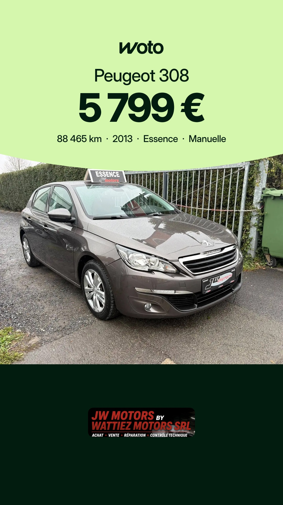
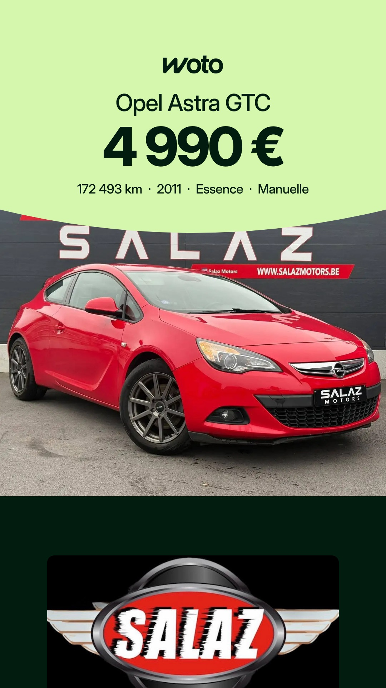
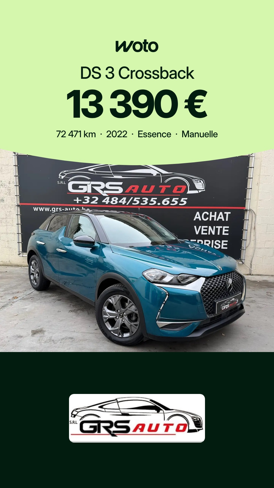
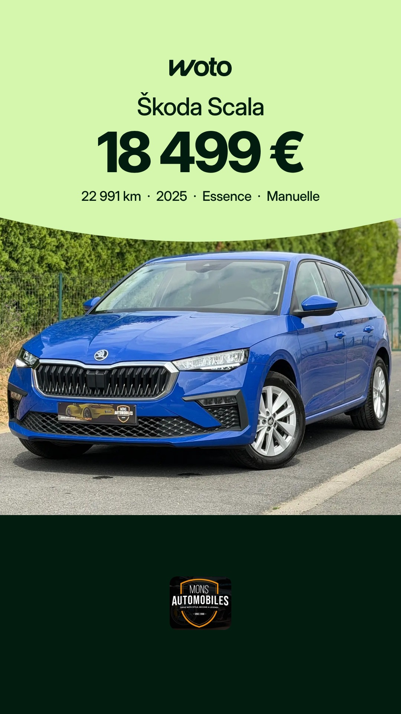
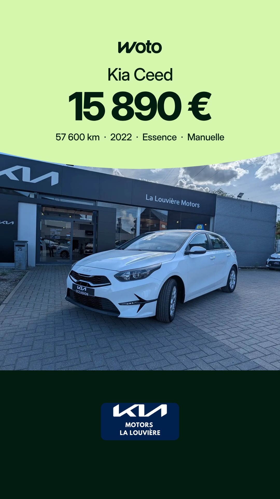
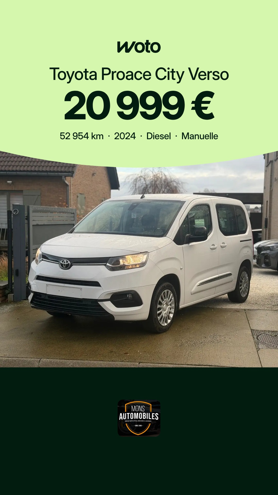
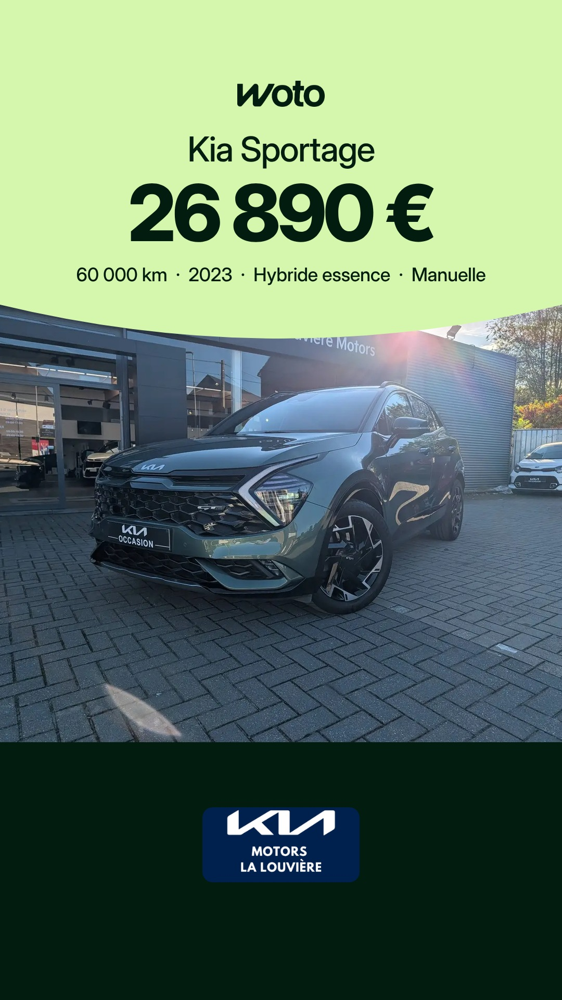

# Planning des stories Woto

Mis à jour à chaque passage. Heures de Bruxelles. Sur chaque story, Facebook et Instagram : sticker « Voir l'annonce → ».

## Mardi 24 novembre

Sorties : 7h30 Dacia Duster (Mons Automobiles), 9h00 Peugeot 5008 (Grs Auto), 10h30 BMW i4 (Garage Privé Wavre), 12h00 Audi Q3 Sportback (DSH Cars), 13h30 Kia Stonic (Kia La Louvière). À venir :

| 15h00 |
|---|
|  |
| Renault Clio, PP Auto |

| 16h30 (programmée 16h00) | 18h00 | 19h30 | 21h00 (programmée 20h00) |
|---|---|---|---|
|  |  |  |  |
| Hyundai Tucson, Grs Auto | Peugeot 308, Wattiez Motors | SEAT Ibiza, Salaz Motors | Volvo V60, Garage Privé Wavre |

Renault Espace (7h30) supprimée : la voiture sort en publication le 25/11.

## Mercredi 25 novembre

| 7h30 | 9h00 | 10h30 | 12h00 | 13h30 |
|---|---|---|---|---|
|  |  |  |  |  |
| Opel Astra GTC, Salaz Motors | DS 3 Crossback, Grs Auto | Škoda Scala, Mons Automobiles | Kia Ceed, Kia La Louvière | Mini John Cooper Works Clubman, Garage Privé Wavre |

| 15h00 | 16h30 | 18h00 | 19h30 | 21h00 |
|---|---|---|---|---|
|  |  |  |  |  |
| Škoda Superb, Salaz Motors | Ford Grand C-Max, Wattiez Motors | Toyota Proace City Verso, Mons Automobiles | Dodge RAM TRX, Garage Privé Wavre | Kia Sportage, Kia La Louvière |

Garage des Chaufours écarté : toutes ses fiches affichent un second prix « pour professionnels ». SabanAuto sauté : aucune photo avec la voiture entière sur les fiches disponibles. DSH Cars et Luxury Cars : pas de fiche neuve valable.

Règles : [RULES.md](RULES.md)
