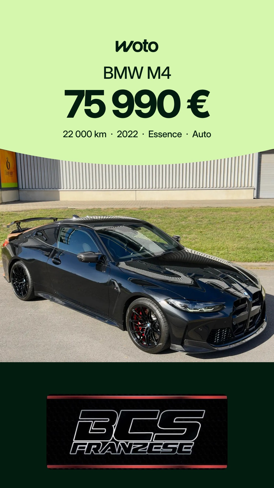

# Planning des stories Woto

Mis à jour chaque matin. Heures de Bruxelles. Sur chaque story, Facebook et Instagram : bouton « Voir l'annonce → ».

## Mercredi 11 novembre

7h30 : pas de story (les visuels d'hier n'avaient pas pu être programmés, ils passent demain).

| 16h | 20h |
|---|---|
|  |  |
| Audi A3, Mons Automobiles | Citroën C5 Aircross, Grs Auto |

## Jeudi 12 novembre

| 7h30 | 16h | 20h |
|---|---|---|
|  |  |  |
| Volkswagen T-Cross, Cardoen Mons | BMW M4, BCS Franzese | Mercedes CLA 180 Shooting Brake, Luxury Cars Center By Alfonso |

Règles : [RULES.md](RULES.md)
