# Planning des stories Woto

Mis à jour à chaque passage. Heures de Bruxelles. Sur chaque story, Facebook et Instagram : sticker « Voir l'annonce → ».

## Samedi 28 novembre

Sortie : 7h30 Mercedes GLA 180 (Ryan Khemir). À venir :

| 9h00 | 10h30 | 12h00 | 13h30 | 15h00 |
|---|---|---|---|---|
|  | 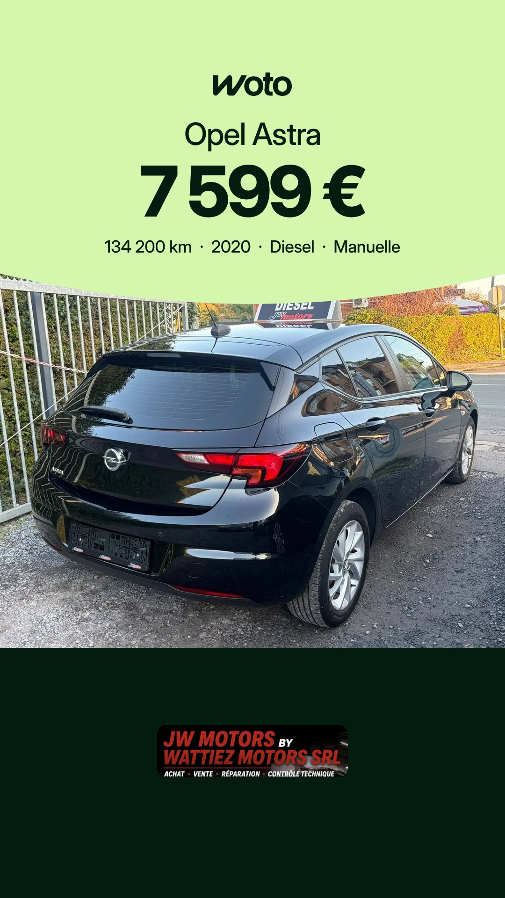 | 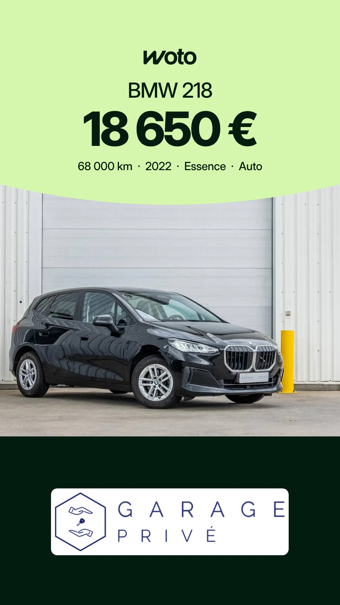 |  | 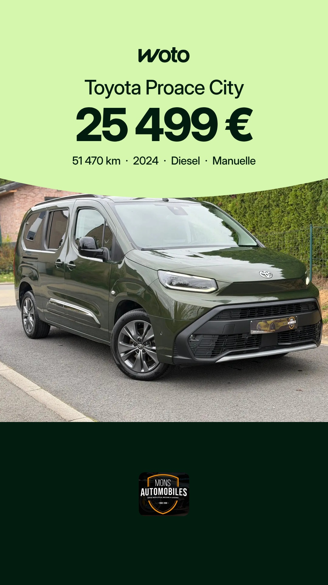 |
| Kia Stonic, Kia La Louvière | Opel Astra, Wattiez Motors | BMW 218, Garage Privé Wavre | Mercedes Vito, Wattiez Motors | Toyota Proace City, Mons Automobiles |

| 16h30 | 18h00 | 19h30 | 21h00 |
|---|---|---|---|
|  |  |  | 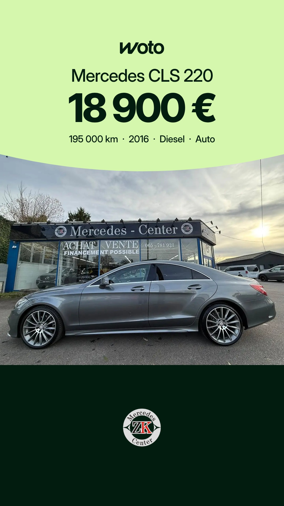 |
| Audi A3, Garage Privé Wavre | Kia Ceed, Kia La Louvière | Peugeot e-208, Garage Privé Wavre | Mercedes CLS 220, Ryan Khemir |

## Dimanche 29 novembre

| 7h30 | 9h00 | 10h30 | 12h00 | 13h30 |
|---|---|---|---|---|
| 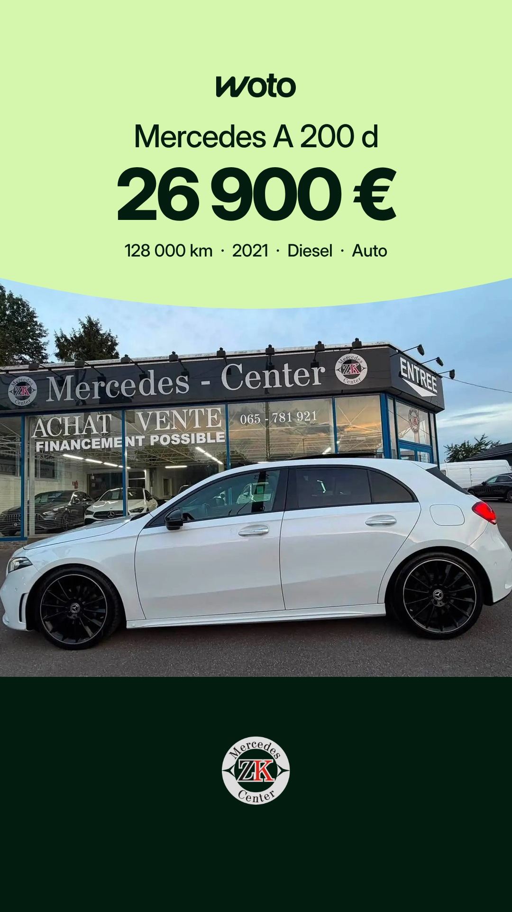 | 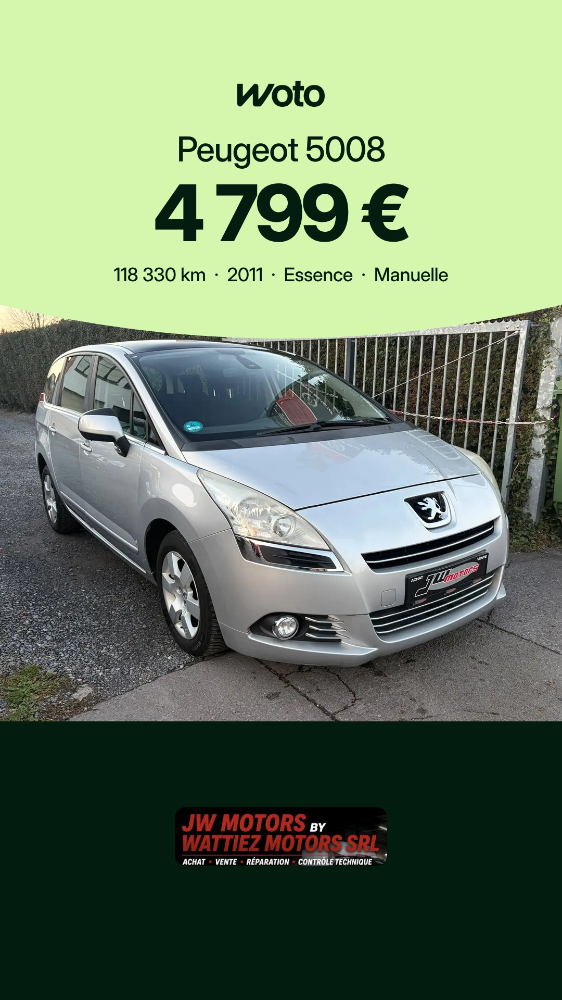 | 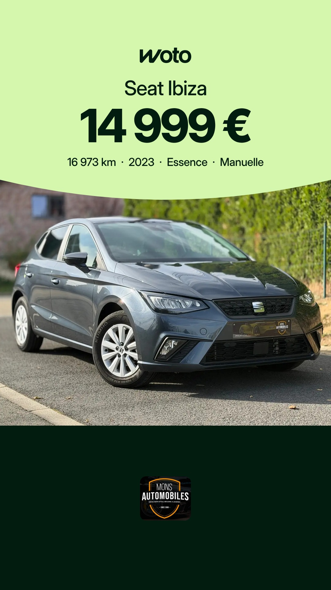 | 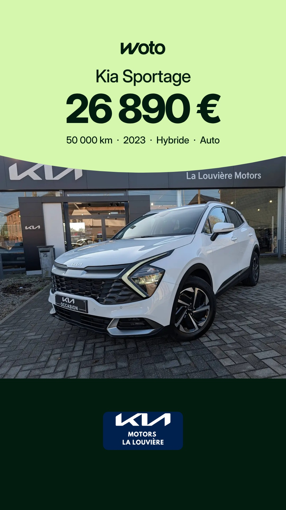 |  |
| Mercedes A 200 d, Ryan Khemir | Peugeot 5008, Wattiez Motors | Seat Ibiza, Mons Automobiles | Kia Sportage, Kia La Louvière | Tesla Model 3, Garage Privé Wavre |

| 15h00 | 16h30 | 18h00 | 19h30 | 21h00 |
|---|---|---|---|---|
| 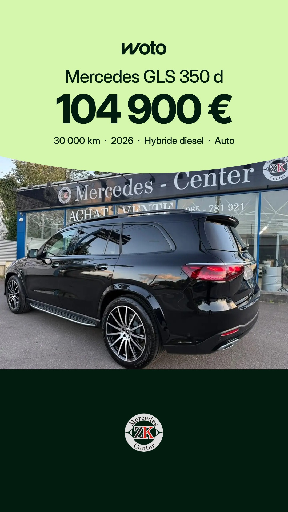 | 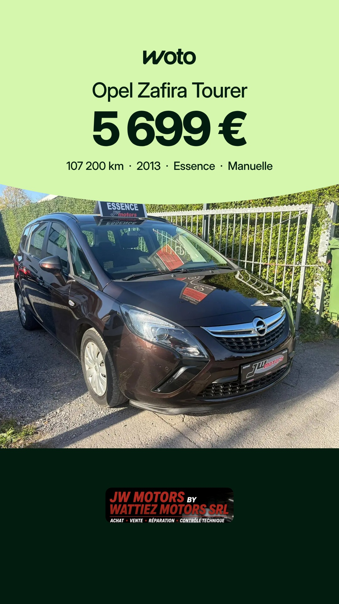 | 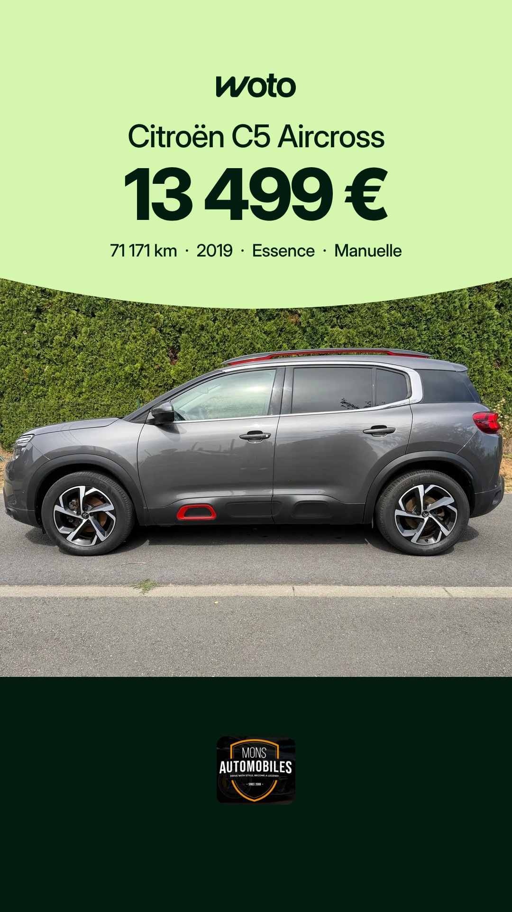 | 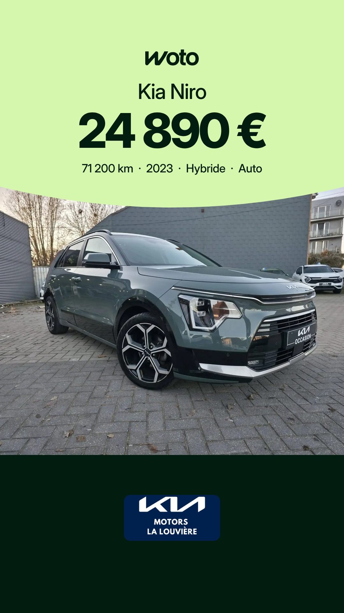 | 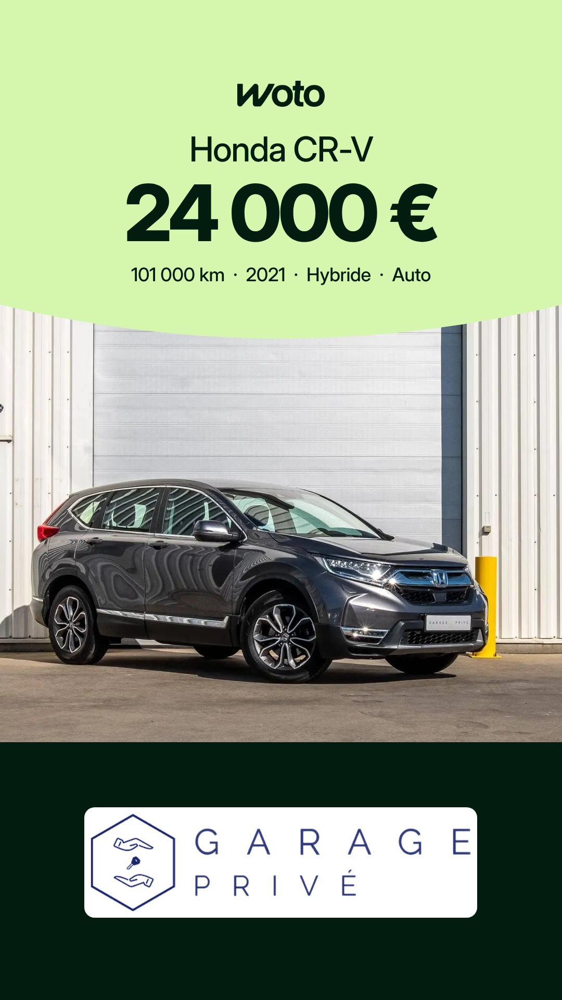 |
| Mercedes GLS 350 d, Ryan Khemir | Opel Zafira Tourer, Wattiez Motors | Citroën C5 Aircross, Mons Automobiles | Kia Niro, Kia La Louvière | Honda CR-V, Garage Privé Wavre |

Toutes des voitures jamais montrées (pas de boucle). Sautés : Salaz Motors (bandeau Salaz et voiture coupée : Golf, Ceed SW), SabanAuto (voiture coupée ou toit sous la courbe sur toutes les photos), Garage des Chaufours (2e prix « Pour Professionnels » sur toutes les fiches), MC Cars (Suzuki, voiture coupée), Luxury Cars (seule fiche : Alfa Giulia 1978 pour pièces). Écartées : Mons Picanto (galerie avec photos d'autres garages), Mons Trafic (prix + TVA), Volvo XC60 SabanAuto (autre prix dans la description), Wattiez Talento et Berlingo (toit sous la courbe).

Passage du 28/11 8h12 : scan 373 fiches (30 motos sans données), 16 garages connus, aucun nouveau garage pro ; agenda Meta complet aujourd'hui (10/10) ; 29/11 : 10 stories programmées FB+IG ; aucun doublon avec les publications, toutes les stories à venir au stock au même prix, rien à rattraper.

Règles : [RULES.md](RULES.md)
