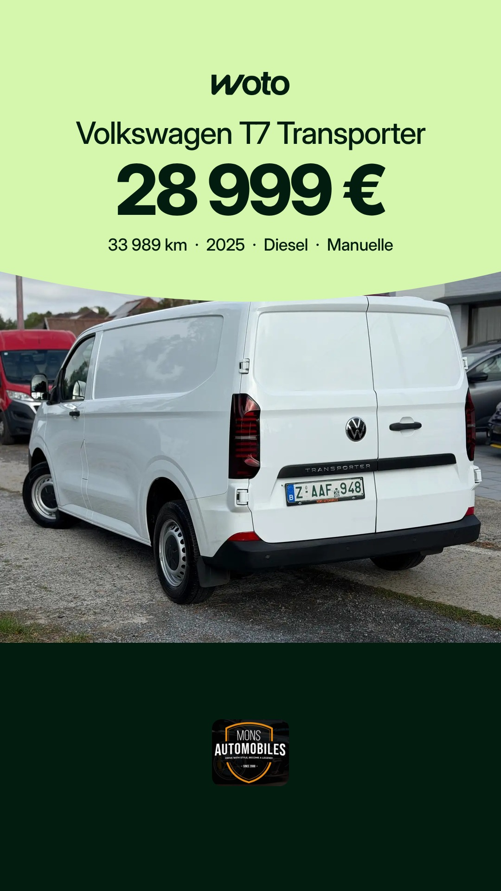
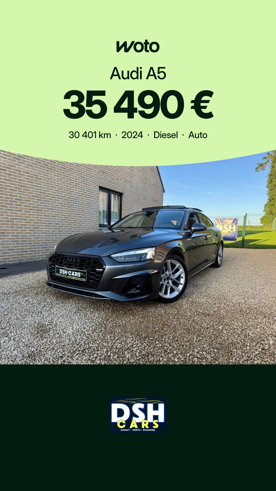
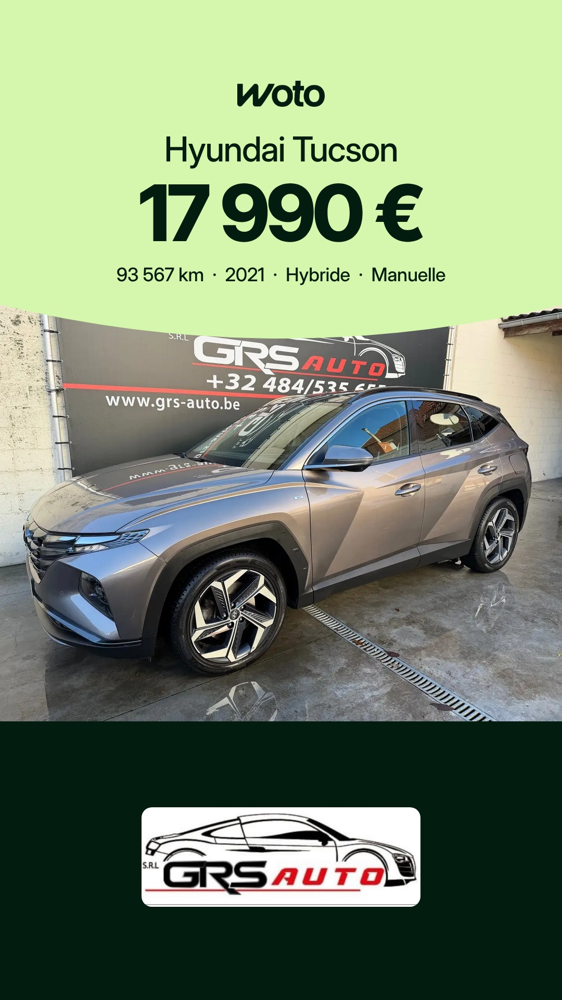

# Planning des stories Woto

Mis à jour chaque matin. Heures de Bruxelles. Sur chaque story, Facebook et Instagram : bouton « Voir l'annonce → ».

## Lundi 23 novembre

7h30 publiée (Fiat Punto, Wattiez Motors), active sur Facebook et Instagram dans l'agenda Meta.

| 16h | 20h |
|---|---|
|  |  |
| Volkswagen T7 Transporter, Mons Automobiles | Audi A5, DSH Cars |

## Mardi 24 novembre

| 7h30 | 16h | 20h |
|---|---|---|
|  |  |  |
| Renault Espace, PP Auto | Hyundai Tucson, Grs Auto | Volvo V60, Garage Privé Wavre |

Règles : [RULES.md](RULES.md)
