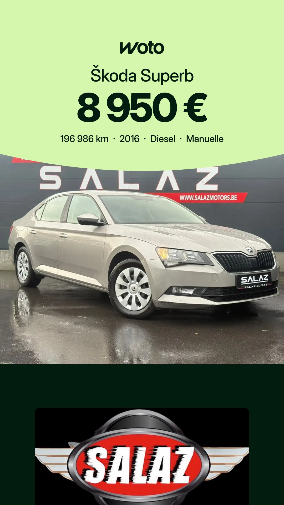
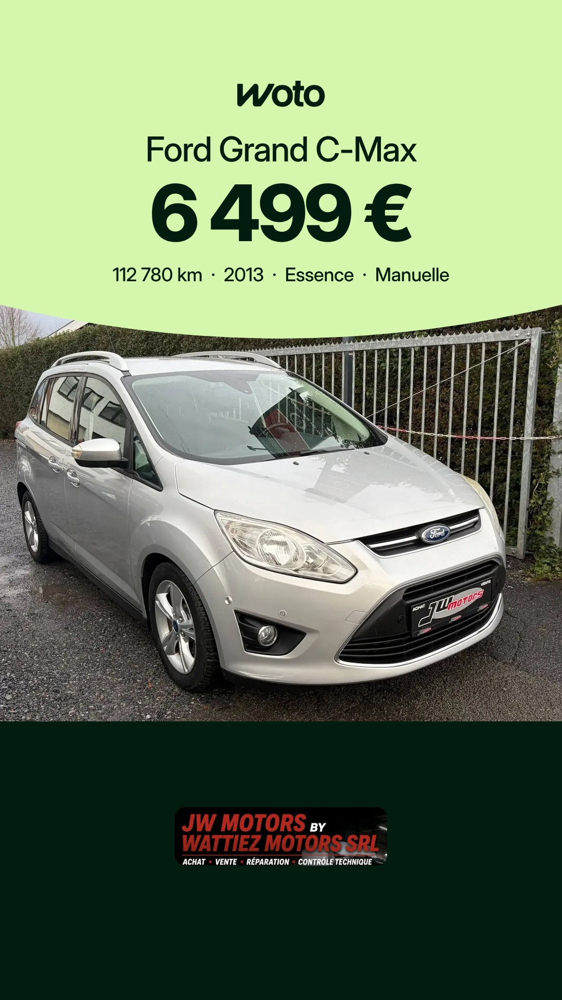
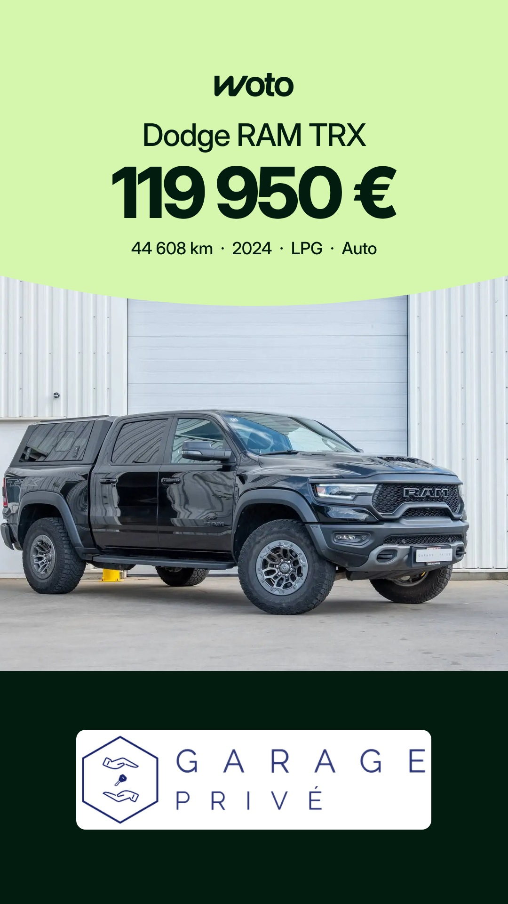
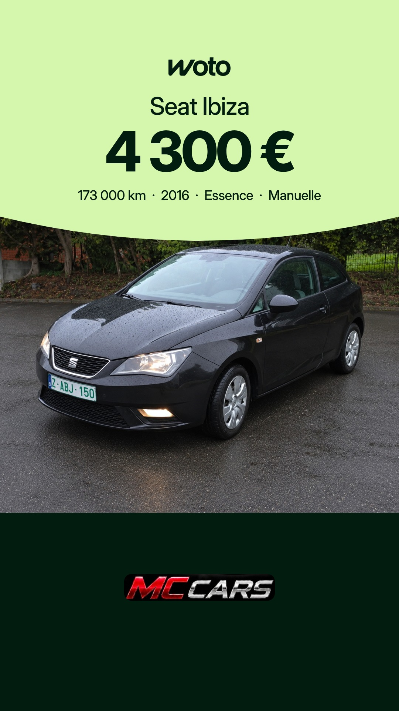
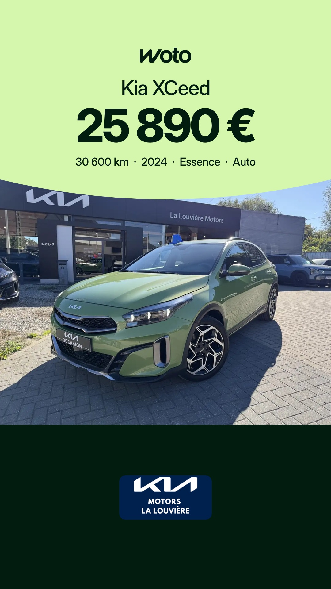
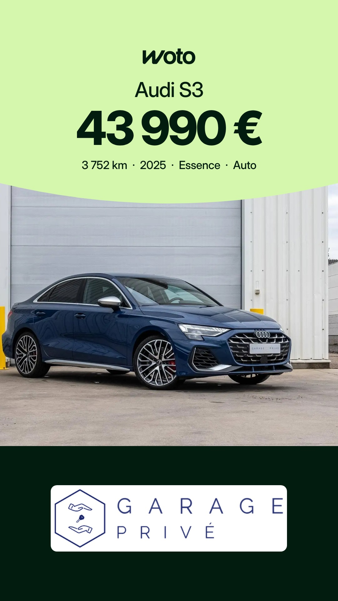
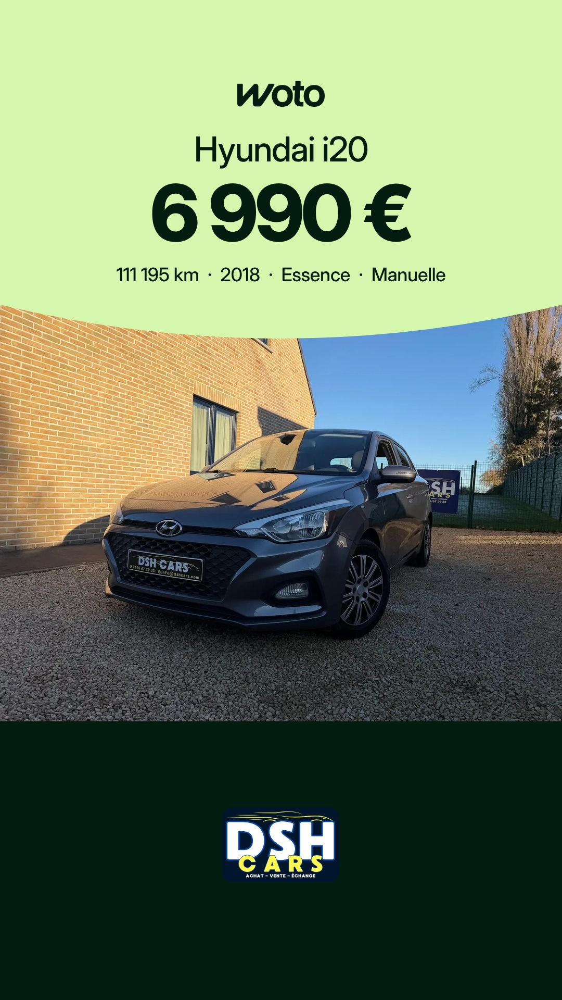
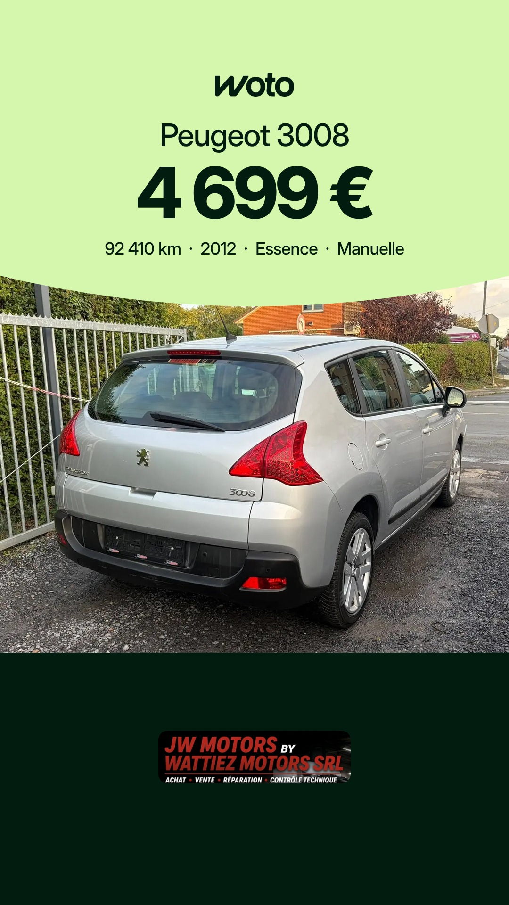
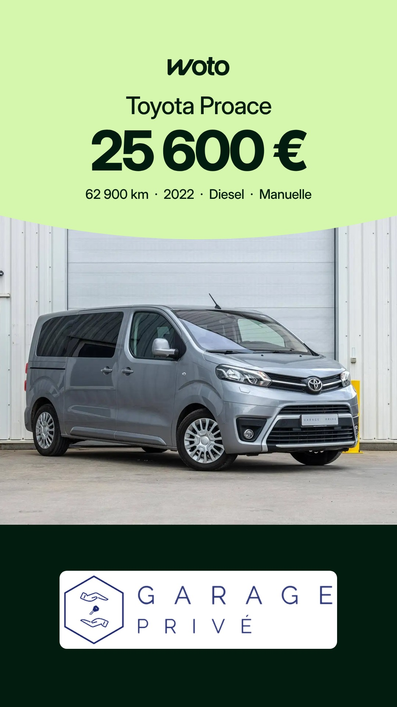

# Planning des stories Woto

Mis à jour à chaque passage. Heures de Bruxelles. Sur chaque story, Facebook et Instagram : sticker « Voir l'annonce → ».

## Mercredi 25 novembre

Sorties : 7h30 Opel Astra GTC (Salaz Motors), 9h00 DS 3 Crossback (Grs Auto), 10h30 Škoda Scala (Mons Automobiles), 12h00 Kia Ceed (Kia La Louvière), 13h30 Mini John Cooper Works Clubman (Garage Privé Wavre). À venir :

| 15h00 | 16h30 | 18h00 | 19h30 | 21h00 |
|---|---|---|---|---|
|  |  |  |  |  |
| Škoda Superb, Salaz Motors | Ford Grand C-Max, Wattiez Motors | Toyota Proace City Verso, Mons Automobiles | Dodge RAM TRX, Garage Privé Wavre | Kia Sportage, Kia La Louvière |

## Jeudi 26 novembre

| 7h30 | 9h00 | 10h30 | 12h00 | 13h30 |
|---|---|---|---|---|
|  |  |  |  |  |
| Seat Ibiza, MC Cars | Kia XCeed, Kia La Louvière | Audi S3, Garage Privé Wavre | Hyundai i20, DSH Cars | Peugeot 3008, Wattiez Motors |

| 15h00 | 16h30 | 18h00 | 19h30 | 21h00 |
|---|---|---|---|---|
|  |  |  |  |  |
| Toyota Aygo, Grs Auto | Kia Ceed, Salaz Motors | Mercedes CLA 180, Mons Automobiles | Citroën C3, MC Cars | Toyota Proace, Garage Privé Wavre |

Toutes des voitures jamais montrées (pas de boucle). Nissan X-Trail (DSH Cars) écartée : 26 990 € dans la description, 25 990 € sur la fiche. SabanAuto sauté : galeries mélangées avec des photos d'autres garages. Garage des Chaufours écarté (second prix « pour professionnels »). Luxury Cars : seule fiche neuve sans kilométrage (Alfa Giulia à restaurer).

Règles : [RULES.md](RULES.md)
